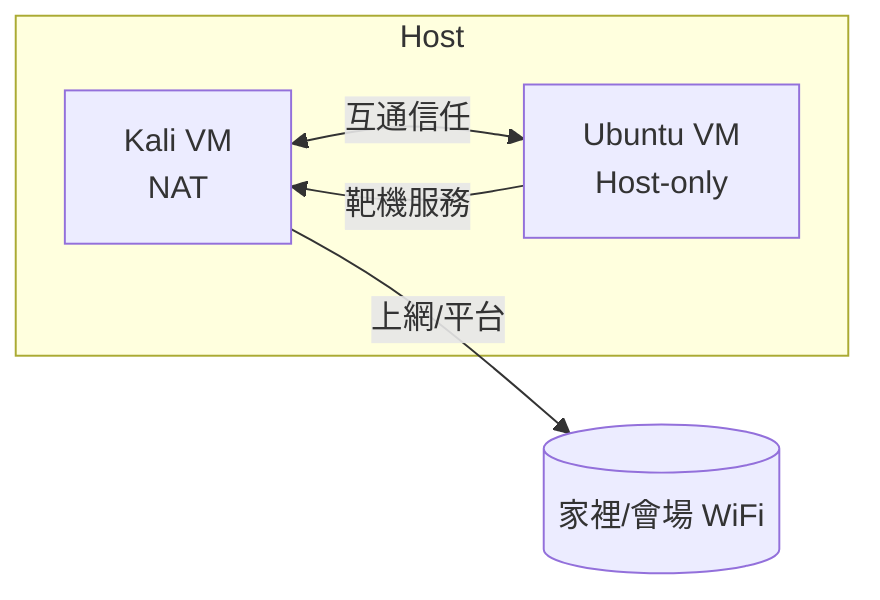

# 第一講 · CTF 環境設置及準備（1 小時）

> 目標：下課後，每位學員擁有一台開機即戰、斷網也能打底的 CTF 作業系統；所有後續課程（方法論、Web、Pwn）都假設這一講的環境已就緒。
> 撰寫日：2026-10（依賴版本以此日為準，安裝時以官方文件最新說明為準）

---

## 0. 課前清單（講師開場 5 分鐘口頭擦拭 Type Check）

| 項目 | 檢查方式 |
|------|----------|
| 電腦可開虛擬化（VT-x / AMD-V） | 工作管理員→效能→「虛擬化：已啟用」（Win）；`system_profiler SPHardwareDataType | grep -i "Virtual"`（Mac） |
| 磁碟 ≥ 60 GB 空間 | VM 鏡像 + 題目檔案 + Docker |
| 記憶體 ≥ 16 GB | 兩台 VM 同時開需要 8+8 |
| 網路可下載（或有同學開熱點） | 下載 ISO/腳本 |

> 若舊機無法開虛擬化：BIOS 開啟「Intel VT-x / Intel Virtualization Technology」，路徑視品牌而異（ThinkPad：Security → Virtualization；Dell：Performance → Virtualization）。

---

## 1. 選型決策：Kali 還是 Ubuntu？

| 維度 | Kali Linux | Ubuntu LTS (22.04/24.04) |
|------|------------|--------------------------|
| 預裝工具 | 600+ 安全工具，開箱即戰 | 什麼都沒有，按需安裝 |
| 一般桌面體驗 | 普通（xfce） | 較好（gnome） |
| 佈署新工具 | `apt install` | `apt`/`snap` 都可 |
| 穩定性 | rolling 更新，偶爾有套件斷裂 | 極穩 |
| 擔心被「玩壞」 | 有快照可用 | 同上 |
| 賽時找到工具的機率 | 高（名字即工具） | 低，要自己補 |

**建議**：主作業機用 **Kali**（學期主用），另開一台 **Ubuntu 24.04** 作為「靶機/乾淨環境/網路服務測試」。兩台加起來約 60 GB。

### 版本固定（2026 年 10 月有效）

- Kali：kali-linux-2026.3-installer-amd64.iso（或直接下 official OVA）
  - https://www.kali.org/get-kali/#kali-installer-images
- Ubuntu Server/Desktop：ubuntu-24.04.3-desktop-amd64.iso
  - https://ubuntu.com/download/desktop

> 為何不用 Windows + WSL2？WSL 對 raw socket、gdb attach、docker 有各種坑（`ptrace`、remote debug 埠、`iptables`），新手不要踩。

---

## 2. 虛擬機平台選擇

| 方案 | 平台 | 費用 | 備註 |
|------|------|------|------|
| VMware Workstation Pro | Win/Linux | 個人用途現已免費（ Broadcom 收購後） | 效能最好，snnpshot 強大；Mac 對應為 VMware Fusion Pro |
| VirtualBox | Win/Mac/Linux | 免費 | 備援選項；M1/M2 Mac 上更穩 |
| UTM | macOS（含 Apple Silicon） | 免費 | Apple Silicon 上可用 ARM images（MIPS/ARM IoT 題好用） |
| Parallels | macOS | 收費 | 效能好但需授權 |

**課堂假設**：Windows 學員 → VMware Workstation Pro；Mac 學員 → UTM（免費）或 Parallels（已有授權）。

### 建立的兩台 VM 規格

| 名稱 | CPU | RAM | 磁碟 | 網路 |
|------|-----|-----|------|------|
| kali-ctf | 4 vCPU | 8 GB | 40 GB | NAT（可上網） |
| ubuntu-target | 2 vCPU | 4 GB | 20 GB | NAT（可上網，稍後隔離用 Host-only） |

> 快照策略：裝完 OS、裝完工具後立刻打一個快照 `BASE-2026-10`。每次把環境弄髒（裝壞套件、系統更新失敗）恢復即可，2 分鐘回到起點。

---

## 3. Kali 環境全自動設置腳本

> 把以下檔案存為 `~/setup-kali.sh`，`chmod +x` 後執行；全程約 15-30 分鐘（視網路速度）。

```bash
#!/usr/bin/env bash
# Kali CTF 環境一鍵腳本（2026-10 驗證）
# 用法: sudo ./setup-kali.sh
set -euo pipefail

echo "=== [1/7] 系統更新 ==="
apt update && apt -y full-upgrade

echo "=== [2/7] 基礎套件 ==="
apt install -y curl wget git zsh tmux unzip net-tools jq \
  python3 python3-pip python3-venv python3-dev build-essential \
  libssl-dev libffi-dev autoconf bison swig \
  gdb docker.io

echo "=== [3/7] Python 環境與套件 ==="
python3 -m pip config set global.break-system-packages true 2>/dev/null || true
python3 -m pip install --upgrade pip
python3 -m pip install requests pwntools beautifulsoup4 lxml \
  flask django sqlalchemy jinja2 pyyaml \
  capstone keystone-engine unicorn \
  frida-tools ROPgadget ropper

echo "=== [4/7] 安全工具 ==="
### 目錄爆破
apt install -y gobuster feroxbuster dirsearch
### 指紋
apt install -y whatweb wappalyzer 2>/dev/null || true
pip install wappalyzer-wrapper 2>/dev/null || true
### 漏洞利用平台
apt install -y sqlmap nikto nmap metasploit-framework
git clone --depth 1 https://github.com/OJ/gobuster /opt/gobuster-src 2>/dev/null || true

echo "=== [5/7] Pwn 環境（pwndbg） ==="
git clone https://github.com/pwndbg/pwndbg /opt/pwndbg &&
  bash /opt/pwndbg/setup.sh
cat > ~/.gdbinit <<'EOF'
source /opt/pwndbg/gdbinit.py
EOF

echo "=== [6/7] Docker（靶機部署用） ==="
systemctl enable --now docker
usermod -aG docker "${SUDO_USER:-$USER}"  # 重新登入生效

echo "=== [7/7] Zsh + Oh-My-Zsh ==="
chsh -s $(which zsh) "${SUDO_USER:-$USER}" || true
sh -c "$(curl -fsSL https://raw.githubusercontent.com/ohmyzsh/ohmyzsh/master/tools/install.sh)" "" --unattended || true

echo "=== 完成 ==="
echo "接下來: 1) 重新登入  2) docker 需登出重登 3) 打 BASE-2026-10 快照"
```

### 驗證腳本（講師/學員共通）

```bash
#!/usr/bin/env bash
# check-env.sh — 逐項打 ✅ 或 ❌
ok(){ printf "✅ %s\n" "$1"; }
bad(){ printf "❌ %s\n" "$1"; }
chk(){ command -v $1 >/dev/null 2>&1 && ok "$2" || bad "$2 (可後補 安裝: $3)"; }

chk python3 "python3"   "apt install python3"
chk pip3    "pip3"      "apt install python3-pip"
chk pwntools "pwntools (python import)" "pip install pwntools"
python3 -c 'import pwn' 2>/dev/null && ok "import pwn OK" || bad "import pwn FAIL"
chk nmap   "nmap"     "apt install nmap"
chk sqlmap "sqlmap"   "apt install sqlmap"
chk gobuster "gobuster" "apt install gobuster"
chk feroxbuster "feroxbuster" "apt install feroxbuster"
chk whatweb "whatweb"  "apt install whatweb"
chk jq    "jq"       "apt install jq"
chk docker "docker"   "apt install docker.io"
docker ps >/dev/null 2>&1 && ok "docker 可用" || bad "docker 無權限 (重新登入/加 usermod -aG docker)"
chk gdb   "gdb"      "apt install gdb"
grep -q pwndbg ~/.gdbinit && ok "gdb+pwndbg" || bad "gdb+pwndbg 未配置"
chk curl  "curl"     "apt install curl"
chk busybox "busybox" "apt install busybox"
echo "— 檢查完畢 —"
```

---

## 4. 瀏覽器「CTF 三件套」擴充套件

| 擴充 | 用途 | 連結 |
|------|------|------|
| Wappalyzer | 一鍵看技術棧（框架/CMS/伺服器） | Chrome/Firefox 官方商店 |
| Foxy Proxy | 切換代理（Burp/ZAP/特定通道） | 官方商店 |
| HackBar / Request Maker | 快速構造請求 | 官方商店 |
| Editoku Cookies | 編輯 Cookie 快速切換身份 | 官方商店 |
| Google 翻譯外掛 | 非中文題直接翻（含內嵌） | 內建 |

**代理專用：Burp Suite Community / ZAP**
- Community 版已夠用（僅缺 Active Scan）；CTF 的流量本來就小。
- 攔截設置：Proxy → Intercept on；瀏覽器抓不到 HTTPS 時記得導入 CA cert（`http://burp` 取得）。

---

## 5. 網路拓撲（賽前 15 分鐘佈好）



- **NAT**：Kali 這台保留。上網抓工具、連平台。
- **Host-only**：Ubuntu 靶機放 Host-only，避免它呼叫外部服務；Kali 透過對應的 Host-only 網卡與它同網段互通。

> 若學員 PC 已裝 Burp（社區版）可先用；否則 `apt install -y burpsuite`。Foxy Proxy 先預設兩個 profile：`Burp 127.0.0.1:8080`、`Direct`。
> 關於平台實際登入方式與 flag 提交介面，見 `04-攻防平台操作.md`；賽前一晚的逐項檢查交給 `05-模板/賽前檢查清單.md`。

### 快速通路測試

```bash
# 本機→Ubuntu 靶機連通
ping -c 2 <ubuntu-target-ip>
curl -sv http://<ubuntu-target-ip>/ | head -5
```

---

## 6. 實用小工具補充

| 類別 | 工具 | 範例指令 |
|------|------|----------|
| 記事 | Obsidian / VS Code + Markdown | 寫 Writeup 用 |
| 快截圖 | flameshot | `flameshot gui` |
| 快靖整理 | CyberChef（離線 Docker） | `docker run -d -p 8088:80 ghcr.io/gchq/cyberchef:latest` |
| API 除錯 | Postman / httpie / curl | `curl -v` |
| DB 登入 | DBeaver（GUI） / `sqlite3` | `sqlite3 db.sqlite .tables` |
| 字典 | SecLists | `git clone https://github.com/danielmiessler/SecLists /opt/SecLists` |
| 離線字典路徑 | `/usr/share/wordlists/` | Kali 內建 dirb、dirb 大字典 |

### SecLists 路徑速查

```
/opt/SecLists/Discovery/Web-Content/common.txt          # dirb 用
/opt/SecLists/Discovery/Web-Content/raft-small-words.txt
/opt/SecLists/Passwords/2020-200_most_used_passwords.txt
/opt/SecLists/Usernames/Names/names.txt
/opt/SecLists/Fuzzing/special-chars.txt
```

---

## 7. PATH / 別名 / 效率微操

把這些放進 `~/.zshrc`：

```bash
# 通用
export PATH=$HOME/.cargo/bin:$PATH
alias l='lsd -a'                # 需 install lsd
alias cls='clear'
# CTF 專用
alias ctf='python3 -c "from pwn import *; print(\"pwntools ready\")"'
alias serve='python3 -m http.server 8000'
alias sniff='sudo tcpdump -i eth0 -n not port 22'
# 常見目錄
alias sec='/opt/SecLists'
# 忘了指令就翻
alias tools='ls /usr/share/webshells'
```

> 設好後記得 `source ~/.zshrc`；若 zsh 無法執行 python 的 venv，切回 bash `chsh -s $(which bash)`。

---

## 8. 常見安裝坑（以及解法）

| 症狀 | 原因 | 解法 |
|------|------|------|
| `pip install pwntools` 失敗 PEP 668 | Debian 12+/Kali 2024+ 外部管理 | `pip config set global.break-system-packages true` 或用 venv |
| `docker: permission denied` | 當前使用者不在 docker 群 | `sudo usermod -aG docker $USER && 重新登入` |
| VMware 開機報 VT-x disabled | BIOS 虛擬化未開 | 開 BIOS 開啟 VT-x |
| Mac M1 上 x64 image 不能開 | 架構不匹配 | 用 UTM + ARM 版 Kali；或開 x86 模擬（效能差） |
| gdb 無彩色、無終端 function | pwndbg 沒裝 | 重新跑 `/opt/pwndbg/setup.sh` |
| 拉包速度極慢 | 連到國外 repo | 換 Mirror（見下） |

**換 Kali Mirror（在中國大陸/澳門會快很多）**：

```bash
# /etc/apt/sources.list
deb https://mirrors.ustc.edu.cn/kali kali-rolling main non-free contrib
deb-src https://mirrors.ustc.edu.cn/kali kali-rolling main non-free contrib
```

**Ubuntu 換 Mirror**：

```bash
# /etc/apt/sources.list 或 .sources 用 GUI「軟體與更新」改 Server 為 Mirror 也行
sed -i 's|http://archive.ubuntu.com|https://mirrors.tuna.tsinghua.edu.cn|g' /etc/apt/sources.list
```

---

## 9. 本地練習靶場（課後自習用）

> 用 Docker 一鍵起靶場，不用外網，不會違法。

```bash
mkdir -p ~/ctf-lab && cd ~/ctf-lab
cat > docker-compose.yml <<'EOF'
version: "3.9"
services:
  # 綜合靶場（新手推薦）
  vulhub-web:
    image: vulhub/weblogic:10.3.6-jdk7
    ports: ["7001:7001"]  # CVE-2017-10271 / 常用入門 WebLogic 案例
    restart: unless-stopped

  # SQLi 練習
  sqli-labs:
    image: acgpiano/sqli-labs
    ports: ["8100:80"]
    restart: unless-stopped

  # 上傳/檔案引用綜合
  upload-labs:
    image: jshark/upload-labs
    ports: ["8200:80"]
    restart: unless-stopped

  # Vulnix 類基礎 RCE 練習（本地模板，不提供外網）
  simple-rce:
    build:
      context: ./simple-rce
    ports: ["8300:80"]
    restart: unless-stopped
EOF
mkdir -p simple-rce && cat > simple-rce/Dockerfile <<'EOF'
FROM php:8.0-apache
RUN echo '<?php system("echo " . shell_exec("modprobe " . escapeshellarg($_GET["mod"]))); ?>' > /var/www/html/index.php
EOF
docker compose up -d
```

> ⚠️ vulhub 鏡像含真實歷史 CVE（如 WebLogic/Struts2）。**只能在 ESCapeshellarg 上對本機/docker 環境使用，不能對外網、不能對他人伺服器**。

### 其他推薦資源

| 資源 | 特色 |
|------|------|
| [picoCTF](https://picoctf.org) | 官方永久開放，CMU 的老牌新手場 |
| [Vulhub](https://vulhub.org) | Docker 化 CVE 環境，與真實產品版本一致 |
| [Hackropole](https://hackropole.fr) | 法國 FCSC 賽題永久練習庫 |
| [OverTheWire Bandit](https://overthewire.org/wargames/bandit/) | Linux 指令與登入邏輯基礎 |
| [CTFtime](https://ctftime.org) | 找「正在進行」的公開賽練手 |

---

## 10. 本講驗收（離場前要能回答）

1. 兩台 VM 名稱、快照名稱是什麼？被玩壞後最低成本恢復流程？
2. `gdb` 接上 pwndbg 的命令、打開 pwntools context 的 Python 語句？
3. `curl http://<ubuntu-target>` 拿到 `404` 頁面，說明網路通了嗎？哪一條鏈路沒通？
4. SecLists 在哪個路徑？拿 `common.txt` 做 gobuster 的完整指令？
5. Docker 起一個 sqli-labs 的指令？它的預設網址、預設帳密？

> 任一答不上：先完成上表對應章節，再繼續下一講。
