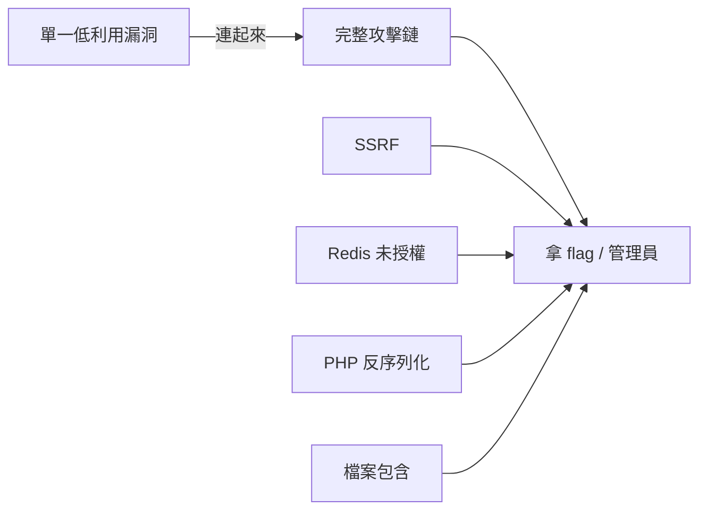

# W7 · 複合邏輯漏洞鏈（30 分鐘）

> 大綱要求「複合邏輯漏洞鏈」；本講把前面單一漏洞連成實戰攻擊鏈，並加入「邏輯漏洞」家族（越權/驗證碼/競態/簽名偽造/IDOR）。

---

## 1 · 為什麼要複合鏈



一句話：**把「掌握的一點資訊」轉化為「下一跳的 entry point」**。
CTF 出題最愛複合鏈，因為個人點特別難。

---

## 2 · 五條常見複合鏈（CTF 模板）

| 鏈 | 組成 | 關鍵 payload |
|---|---|---|
| SSRF → Redis | gopher + redis 未授權 | 見 W5 §1.3 |
| SSRF → 反彈 shell | 先 wave 的 handshake、後 writeFile | |
| LFI → 日誌污染 → RCE | access.log + `<?php` | 見 W4 §4.1 |
| LFI → zip → phar | 上傳 zip + `phar://` | 見 W4 §4.4 |
| SSTI/反序列化 → 上傳其他資源 | `render` / `unserialize` | 見 W6 |

### 2.1 SSRF → Redis 複合示例（本課堂 demo 鏈）

```text
①  外部 SSRF 觸發:
   /fetch?url=gopher://127.0.0.1:6379/_*1%0d%0a$8%0d%0aflushall%0d%0a*3%0d%0a...
② Redis 寫 webshell（config set dir + dbfilename)
③ 拿 shell → flag
```

> 剛刮灑一把 retrieve1 三條 all-on-my flag）*var/log/… 的 *_並未* 100% 好用。
> 講師在此提供完整 shell 腳本（generates gopher URL from a raw redis cmd list; 見練習 §「17」）。

---

## 3 · 「邏輯漏洞」家族（無明顯注入面時的重點）

| 類型 | 典型場景 | 典型 payload/操作 |
|---|---|---|
| 越權（IDOR） | `?id=1001` 想看別人的 | 遍歷 id 或改成低 id |
| 權限升級 | cookie/isAdmin 可以自改 | 簽名偽造或簽名算法弱點 |
| 驗證碼邏輯 | 每次都不重置、不失效 | 重放 |
| 競態（Race Condition） | 折扣券、提現、優惠 | 併發請求（Burp Turbo Intruder） |
| 簽名繞過 | 驗簽資料可拆裝 | `t=1` → `timestamp=` 空 |
| 參數注入 | 免費/價格 | `price=-1` 負數繞 |
| 密碼重置邏輯 | 舊 token 不失效 | 猜時序 |
| SQL→邏輯：寫資料轉帳邏輯 | 負數支付 |

常見為 **「接受一串數字變動」** 的賽場，這裡展示最實用三種：

### 3.1 競態條件（Race）

**情境**：領完現金 `POST /withdraw` 關閉帳戶情況：

```python
# Burp Turbo Intruder 一鍵 poems；也可用 python
import threading, requests
URL = "http://target/withdraw"
data = {"amount": "1000"}
def hit():
    while True:
        r = requests.post(URL, data=data, cookies=COOKIES)
        if "balance" in r.text:
            print(r.text); break
for i in range(100):
    threading.Thread(target=hit).start()
```

**預期**：同時請求 → 兩次都過了「balance >0」判斷 → 兩次都被扣（或多返）。
**signature**：一秒內出現越多着的成功越多，像抽獎。

### 3.2 IDOR.

```text
?order_id=100001   → 我們打日記
?order_id=100000   → 別人的訂單
# IDOR 通常由 「自訂 key ( ids ) 」走 route param 不做驗證。
# 我們一 修補 cookie 會驗; 拿 cookie 的 id 進行對照.
```

### 3.3 簽名偽造（線上上次提現及 hash 的核對）

```javascript
// 假設簽名是: md5("amount" + price + "&time=" + time)
price = "100"
time = "1400000000"
hash = md5("amount100&time=1400000000")  
// 貼到 price=10 & time="1400000000" (同 hash!) → 後端比對 md5 是不同
```

> 白語言最多 sho w：hash 算法要 include **all** 的參數（no sort or no prefix）。
> CTF 提示常為：`sign=md5(price+time)`，那麼 `time=100&price=100` 完全有效。

---

## 4 · JWT 攻擊（深度融合一部）

```text
1. alg:none    > 將 alg 改為 none，把簽名部分隱藏
2. 密鑰爆破  > jwt-tool -C –d SECRET_LIST
3. kid injection  > kid="1' union … / kid="␣␣"
4. HS256 vs RS256  > 公鑰為「簽 私鑰, 無 RS256」可用 weakkey
```

> 工具：`jwt.io`（前台解讀）、`jwt_tool`（攻擊腳本）、`hashcat -m 16500`。

**JWT 修補**：
- `alg` 白名單：只允許 HS256/RS256。
- 密鑰長度 ≥ 256 bits，不洩露公私鑰共用之 Hashing。
- kid 定義為 `kid` 單一型，僅允許數字或長度限制。

---

## 5 · 認證/驗證碼繞過（常見 Composite）

```text
1. 直接修改 response (前端 JS 驗證)
2. 重放   (無令牌失效或者無 nonce)
3. 取整個 cookie 串性; 為瀏覽器暗紋
4. 弱式 SESSION (自行手動以一個固定 ID)
5. 對 「 TOKEN 生成為 (timestamp-userid)」 的進学
```

> 「CAPTCHA」是 OpenCV 過不去（數方撒網），多采用這條鍊「authorization 原理 presentation」。

---

## 6 · 複合鏈の思維定式（四個判別）

```text
① 下一跳在哪?  「內部 panels: Redis/db/Docker api/Metadata」；
② 網路隔離? 「容器架的純內網, 必须在 SSRF 內進行 jump」；
③ 權限隨機? 「flag 位元於 root / flag environment：難度在 privilege」;
④ 密碼/金鑰的可控面: 「JWT/session/token/DB 密碼」。
```

---

## 7 · 課堂練習（15 分鐘，3 組）

| 練習 | 型態 | 說明 |
|---|---|---|
| 練習 21（越權 IDOR） |簡 | 遍歷 1000 筆訂單 |
| 練習 22（JWT 弱簽名） | 中 | 爆金鑰 + alg none |
| 練習 24（競態條件領券） | 中 | 多線程成功重複收券 |

---

## 8 · 講師提示

- 讓學員先複述「單一漏洞輸入」 能做到什麼，再打開「跳到下一步」討論。
- 複合鏈本課強調「**使用內網**」的層次：不開內網也不見得沒有鏈，注意「內部會話」。
- Burp Turbo Intruder 的排除法在賽前 練習 完成（用練習 24）。
