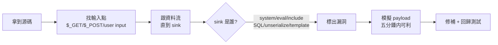

# W8 · Web 程式碼審計與修補 · Code Review 與 Patch 實作（20 分鐘 · 須 demo）

> 對應大綱「Web 題目 Code Review 與 Patch 實作（須 demo）」。
> 內容：五類漏洞的「源碼→漏洞→修補」三欄 demo，以及 AI 輔助審計的模板化流程。

---

## 0 · 審計流程總覽



**拿到源碼後 3 分鐘三板斧**：
1. `grep -n "checkboxes`，全檔案標註輸入點（見下表）。
2. 對每個輸入點追蹤它最後去了誰那裡（`trace` 而不是「讀一遍」）。
3. 想最短 payload 驗證 —— **可以利 -> done**，不能利 -> 説明為啥（防禦點在哪）。

### 0.1 各語言的輸入點速查

| 語言 | 輸入 | sink |
|---|---|---|
| PHP | `$_GET/$_POST/$_COOKIE/$_REQUEST/php://input/起居 headers` | `system/exec/include/eval/unserialize/…\.sql` |
| Python | `request.args/form/files/headers/json` | `os.system/exec/eval/pickle.load/template.render` |
| Node | `req.query/body/params/headers` | `child_process/exec/eval/mongo collection  query` |
| Java | `request.getParameter/getInputStream/readObject` | `ProcessBuilder/XMLDecoder/JNDI/手動 SQL` |

---

## 1 · SQLi 審計與修補

### 1.1 漏洞代碼（常見 CTF 題目源碼）

```php
<?php
$id = $_GET['id'];
$conn = mysqli_connect('db','user','pass','ctf');
$ary = mysqli_query($conn, "SELECT * FROM post WHERE id={$id}");  // 直接拼字串
while ($row = mysqli_fetch_array($ary)) { echo $row['title']; }
```

**漏洞三處**：
1. `$id` 未檢查
2. 字串拼接 SQL
3. 抓不到單層引號依賴 —— 當 `$id` 為 `' or 1=1 -- ` 時直接命中

### 1.2 驗證 payload（五分鐘可利）

```text
GET /?id=-1 union select 1,table_name,@@version from information_schema.tables where table_schema=database() limit 0,1
# 付出 ` post_title`… —— 若是首版源碼無法修 — 就是這條線
```

### 1.3 修補後代碼（prepared + 白名單，一次性到位）

```php
<?php
$id = intval($_GET['id'] ?? 0);                  // 雙保險
$stmt = $conn->prepare("SELECT id,title FROM post WHERE id = ?");
$stmt->bind_param("i", $id);
$stmt->execute();
$res = $stmt->get_result();
while ($row = $res->fetch_assoc()) { echo htmlspecialchars($row['title']); }
```

**原理標註**：
- `prepare` 完成後 SQL 語句定型，之後僅作為資料綁定 —— 無論傳什麼都不會變語意。
- 白名單是絕對必要的—— 若 `prepare` 而後仍拼 `ORDER BY $x`，仍可注入。

---

## 2 · XSS（殭屍小還是 DOM？）

### 2.1 漏洞代碼 / payload

```php
<?php echo $_GET['q']; ?>
GET /?q=<script>alert(document.cookie)</script>
```

修補：

```php
<?php echo htmlspecialchars($_GET['q'] ?? '', ENT_QUOTES|ENT_SUBSTITUTE, 'UTF-8'); ?>
```

> 原則：**檢查上下文**。在 HTML body 用 HTML encoding；在標籤屬性用 quote；在 JS 內用 JSON encode + `json_encode`；在 URL 用 urlencode。修補的 `UTF-8` 加上 ENT_QUOTES 缺一不可。

### 2.2 存储型 / DOM XSS

- 存儲型：`echo htmlspecialchars($row['comment'])` 記者在長期儲存處（DB/comment 板塊）必須檢查 DB 內容，不做「臨時產生」輸出的 XSS。
- DOM XSS：檢查 `element.innerHTML = caline(0) …`，改為 `textContent = …`。

---

## 3 · 命令注入

### 3.1 漏洞

```php
<?php system("ping -c 1 {$_GET['ip']}"); ?>
```

### 3.2 修補（兩個選項）

```php
// 選項一，PHP 允許的 escapeshellarg 
$ip = escapeshellarg($_GET['ip']);
system("ping -c 1 $ip");

// 選項二，純白名單 + 排除 hack 符號
$ip = $_GET['ip'];
if (!filter_var($ip, FILTER_VALIDATE_IP)) die("bad ip");
system("ping -c 1 " . escapeshellarg($ip));
```

> 註：若語言支持（PHP 參加 `escapeshellarg`），**單用 escapeshellarg 即可**；但 PHP `system` + 卻的 `$cmd` 二命令的**shell 參數注入**要用 `proc_open` 限制地下水。
>
> Python 則用 `subprocess.run(['ping','-c','1', ip])`（list 形式不過 shell）。

---

## 4 · SSTI

### 4.1 漏洞

```python
@app.route('/greet')
def greet():
    name = request.args.get('name', '')
    return render_template_string("Hello " + name)
```

`name` 直接拼進模板字串 → {{…}} 即代碼。

### 4.2 修補

```python
# 對的方法：不把用戶輸入拼進模板字串，而把它當上下文參數
return render_template_string("Hello {{ name }}", name=name)
# 上下文參數是純資料，不會被 Jinja eval。
```

> 不同 SSTI 的「防禦」冒新一代一起：不要 user input 造成的模板字串。真的必要使用模板引擎時可用 `jinja2.sandbox.SandboxedEnvironment`，且注意 `filter` 的 `toJSON`、`arg` 限制。）

---

## 5 · 原型污染（Prototype Pollution，Node 題必備）

### 5.1 漏洞：

```javascript
function merge(a, b) {
  for (let key in b) {
    if (typeof b[key] === 'object' && b[key] !== null) {
      a[key] = a[key] || {};          // 不過 range 這裡也會建
      merge(a[key], b[key]);
    } else { a[key] = b[key]; }
  }
  return a;
}
// front-end 送: {"__proto__":{"polluted":"yes"}}
merge({}, JSON.parse(body));
zhihu;h (new Object()).polluted === 'yes'
```

### 5.2 修補

```javascript
function safeMerge(t, s) {
  for (const k of Object.keys(s)) {
    if (k === '__proto__' || k === 'constructor' || k === 'prototype') continue;   // 黑名單
    if (typeof s[k] === 'object' && s[k] !== null && !Array.isArray(s[k])) {
      t[k] = t[k] || {}; safeMerge(t[k], s[k]);
    } else t[k] = s[k];
  }
  return t;
}
// 其他: Object.create(null)；` lodash defaultsDeep` 有風險，故最新版 (>=4.17.12)
```

### 5.3 原型污染的可怕之處（全面影響其他 app）

```text
"__proto__": {"isAdmin": true}   → 整個環境很多 obj 都取得 isAdmin
"__proto__": {" auctionD": "yes"} → 其他!obj 可以跨 app 生效
```

---

## 6 · Patch 檢查清單

| # | 項目 | 常見錯誤 |
|---|---|---|
| 1 | prepare 的占位符使用是否正確（每個用戶輸入都有 placeholder） | 筆誤 `\u0022i\u0022` 與 `ii` 誤用 |
| 2 | 白名單是「後端列表」而非黑名單 | 黑名單防白名單主流（`or 1=1` 未含） |
| 3 | `escapeshellcmd`、`htmlspecialchars` 的 flag | ENT_QUOTES/ENT_SUBSTITUTE 的金額 |
| 4 | CSRF token / Session ID 的「唯壹」驗證 | 前端自改失败 |
| 5 | 修補後回歸 | 修了 A 產生 B 的 site 另種 patch |
| 6 | 測試框架 | throwaway script（不加 regression test）必須有效 |
| 7 | Must-to-learn：`oauth`、`state` 驗證的流程 | oauth variant |

---

## 7 · AI 輔助 Code Review 實戰（本課堂 5 分鐘 demo）

### 7.1 演示方式（二步驟）

**Step1 —— 把源碼貼給 AI，問這句**：

```text
你是 PHP 安全審計專家。請：
1) 列出每個漏洞點（輸入點 + sink）
2) 每個漏洞給 1 個最短 exploit payload
3) 每個漏洞給出最小修補代碼（含 PHP 語境必要的 escape）
4) 標明每條修補的副作用
```

**Step2 —— 讓人工驗證關鍵 payload**：

```text
請逐行驗證你上面 payload 的語法，有沒有引入不存在的函數或 CRM 項目?
```

### 7.2 用 AI 的「真實化」技巧

| 技法 | 說明 |
|---|---|
| 把 100 行源碼一次給 AI | 較拿 `form` 与 `sink` 兩行 |
| 「僅輸出漏洞點」一步到位 | 而不是整段複製 |
| 「您的每個修補語句的副作用」  | 心態打斷「一次搞定」 |
| 「若有 union select，還有哪個 column 被漏出」｜測試 completeness |

---

## 8 · 課堂 demo 劇本（講師須備）

| 時間 | 演示步驟 | ︎備註 |
|---|---|---|
| 0–2 min | 打開 PHP 源碼，誦出「輸入點 → sink 」兩步 | 板書兩個詞 |
| 2–5 min | 給 1 句 attack payload、馬上源碼，CAS 顯示執行 | 不布值標短例 |
| 5–10 min | 双打 prepared statement 版本 + escapeshellarg 版本，重新執行 | 修補前後對比 |
| 10–15 min | AI 輔助: 同一段 code、兩問（漏洞列表/防禦改版），且點出 AI 第 1 輪給的 2 個錯誤 | 逐步 instr. |
| 15–20 min | 讓學員選一題在手機/電腦跑完成：練習 25 (審計) | 用 `04-練習/Web練習題集.md` |

---

## 9 · 本課驗收

1. 講出五種 sink 的代碼修法各一種。
2. 何時用 prepared 不是「必理論」而是「上下文（ORDER BY / LIMIT）」不能改。
3. 對一個 60 行的 PHP 站，**你可 90 秒内**說出「2 個最主要的 patch 点」並且可說出「那兩個的点在 <20 字元的代碼」。

---

## 附錄 · 防禦檢查清單（平行材料）

修補 demo 結束後，請用一頁紙勾選驗證與回滾項（**不含攻擊步驟**）：

→ [05-模板/Web08-防禦檢查清單.md](../05-模板/Web08-防禦檢查清單.md)

課程邊界見倉庫根目錄 [COURSE_BOUNDARY.md](../COURSE_BOUNDARY.md)。
