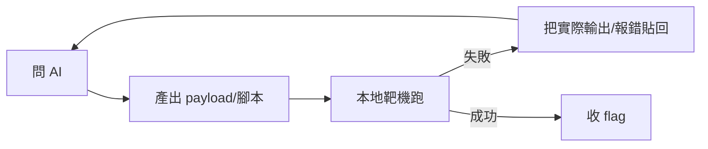

# 第三講 · AI 輔助攻防技術導論（1 小時）

> 目標：讓每位學員在賽場上，能以「提示詞工程」的方式把 AI 用在 5 個高價值場景（情報加速、payload 生成、代碼審計、原理問答、報告初稿）；同時建立「不信任 AI 輸出，必須本地驗證」的肌肉記憶。
> 前置：無需程式基礎；若有第一講環境更好。

---

## 0. 賽前必答的兩個問題（3 分鐘）

1. **本賽事是否允許 AI？** 賽前研讀規則（見 `04-攻防平台操作.md` §3.5）。如果賽制不允許 AI 參賽，這一講的內容會轉為「賽後復盤用」。以賽制公告為準。
2. **斷網/斷 AI 怎麼辦？** 備好離線方案：本地模型（Ollama + qwen2.5-coder）或預先下載的提示詞庫與漏洞字典（`05-模板/AI提示詞庫.md`）。

---

## 1. AI 在 CTF 中的五個高價值場景（10 分鐘）

| # | 場景 | 情境 | 產出 | 風險 |
|---|------|------|------|------|
| A | **情報加速** | 題目給的資訊很多，需要有人整理思路 | 分層掃描清單、優先級排序 | 錯誤斷言被當事實 |
| B | **payload 生成** | 「試試 SQL 注入的 5 種繞法」 | 可貼的 payload 列表 | 語法/注入點不匹配，浪費時間 |
| C | **代碼審計** | 拿到源碼，需要找漏洞 | 可疑行清單+修補建議 | 幻覺函數/虛構漏洞 |
| D | **原理問答** | 遇到新技術（如 protostar 的輸出） | 一步一步解釋、案例 | 過時版本資訊 |
| E | **報告初稿** | 解題後需寫 writeup | 標準結構初稿 | 過度修飾、失真細節 |

**大原則**：AI 是「放大器」，不是「替代者」。你對目標的了解、對環境的觀察，是 AI 給不出來的。

---

## 2. Prompt 工程基礎：把 AI 當作「非常博學但不看你的螢幕」的隊友（15 分鐘）

### 2.1 萬用提示詞結構

```text
[角色] 你是資深 CTF 選手，專長 <Web/Pwn/Reverse>。
[情境] 我正在打 <賽事名>，題目分類 <類>，難度 <難>。
[目標] 我要在 <N> 分鐘內拿到 flag，flag 格式 <flag{...}>。
[事實] 我已知：<版本、指紋、可訪問端點、錯誤訊息、已試 payload>
[限制] 不得使用需要出網的方法；不得使用 <該場明確禁止> 的手段。
[輸出] 請輸出：(1) 3 個最可能的方向 (2) 每個方向的第一個可執行 payload (3) 失敗時的下一步。
[不要] 不要虛構 CVE；不要修改我貼的代碼；不要猜測未給的資訊。
```

> **為何這樣有效**：AI 的缺點是「給太多不相關」。明確的 `[限制]`/`[輸出]`/`[不要]` 相當於給它套上「必須丟出可動作」的框架。

### 2.2 情報加速（場景 A）的現成模板

```text
我有一個 Web CTF 題目，URL: http://10.10.10.5:8080/
已觀察到:
- 標頭: Server: nginx/1.18.0, X-Powered-By: PHP/7.4.3
- 首頁含 <form action="login.php" method="POST">（欄位: user, pass）
- /admin 回 302 → /login.php
- robots.txt 存在，含 Disallow: /backup/
- 沒有 git/svn 目錄

請給我:
1) 5 分鐘內要做的 3 個動作（具體命令）
2) 若 /backup/ 存在，下載後的 3 個優先檢查點
3) 若以上全空，下一步信息收集方向
```

### 2.3 Payload 生成（場景 B）的現成模板

```text
生成 5 個 SQL 注入 payload，目標是 MySQL 5.7，注入點在
GET /item?id=1（數字型注入，無引號）。
後端會把下列關鍵字替換為空: select, union, space, and, or
（具體正則未知；逐個測試請給我 payload 並說明繞過了哪個黑名單）
```

### 2.4 代碼審計（場景 C）的現成模板

```text
以下是 CTF 題目的一部分 PHP 源碼。請找出所有可能被利用的漏洞，
按嚴重度排序，並對每一條給出：漏洞類型、觸發 payload、最小修補代碼。

（貼上源碼）
```

### 2.5 原理問答（場景 D）的現成模板

```text
請用中文，像帶 CTF 新手一樣解釋「格式化字串漏洞」：
1) 漏洞的本質（printf 的處理流程）
2) 為何 %n 可以寫入記憶體（配合一個 4 行 C 示例）
3) 為何與 NX/PIE/RELRO 的關係
4) 給我 3 個練習建議（本地題目與 vulnhub 名稱）
```

### 2.6 報告初稿（場景 E）的現成模板

```text
幫我按下列結構寫一份 writeup 草稿，事實以我貼的內容為準，不得虛構：
# 題目  <name>
## 偵察        (我在 <時間> 做了什麼)
## 分析        (漏洞鏈、依據)
## 利用        (payload 與輸出片段)
## 收穫        (技術點, 卡點, AI 幫助了哪一步)
我提供的原始筆記: <筆記>
```

---

## 3. 進階：把 AI 用在「反覆迭代」而不是「一次性」（20 分鐘）

### 3.1 迭代循環（AI 最大價值所在）



**關鍵點**：失敗時不要重寫整個 prompt；只貼「實際輸出 vs 期望輸出」的差異。AI 對 delta 的反應比對完整重述更準。

### 3.2 案例：讓 AI 幫你把「手工 SQL 盲注」變「腳本」

```text
我把這個 payload 手工測了：/item?id=1' AND SUBSTR((SELECT user()),1,1)='r' -- -
返回 200 與正常內容；改成 'a' 則內容消失 → 確認是布爾盲注。
請生成一個 Python 腳本：
- 自動擴展字元集 A-Za-z0-9_{}
- 逐字元提取 (SELECT table_name FROM information_schema.tables WHERE table_schema=database() LIMIT 0,1)
- 逾時/異常處理
- 每步打印進度
```

> 這條 prompt 體現「把事實給足，AI 才不會猜」——你先手工確認布爾行為，AI 只需要寫循環。

### 3.3 讓 AI 幫你反編譯程式碼（Pwn 隊友最愛）

```text
以下是 IDA 反編譯輸出（32-bit x86，strip 後）。請：
1) 恢復變數語意（哪個是 buffer、哪個是 size）
2) 指出所有可能溢位/未檢查的輸入
3) 給出 pwntools 的骨架（含 offset 計算）
反編譯輸出: <貼上>
```

---

## 4. 幻覺防制：AI 會說謊，但這些檢查能擋住（10 分鐘）

### 4.1 幻覺三類型

| 類型 | 例子 | 驗證方法 |
|------|------|----------|
| **函數/參數虛構** | `requests.post(url, files={'f': file, 'params': {...}})` | `python3 -c "import requests; help(requests.post)"` |
| **CVE/時間/版本錯誤** | 說「CVE-2022-99999 存在」 | NVD 搜尋；vulhub 確認 |
| **語法/語意錯位** | Jinja2 沙盒裡寫 `{{ ''.__class__.mro() }}`（缺底線） | 本地 3 行腳本執行；或 `python3 -c "print(...)"` |

### 4.2 反幻覺的四道工序

1. **要求 AI 附出處**（官方文檔連結 / GitHub commit），沒出處的命令不直接執行。
2. **在本地靶機先跑**——賽前把常見 payload 清單本地驗證過。
3. **讓 AI 自查**：「請你逐行驗證你上段 payload 的語法是否正確，有無虛構函數」，它常會自己發現 1-2 個錯。
4. **第二意見**：把同一問題貼給另一個模型；兩邊一致的可能性越高，可信度越高（但不是絕對）。

---

## 5. 課堂練習（15 分鐘，分組）

> 目的：實際感受「好的 prompt vs 壞的 prompt」之間的速度差。

**壞 prompt 示例**（先貼出，讓大家預測回覆品質）：
```text
解一下這個 CTF 題：http://10.10.10.5/
```
→ 缺版本、缺描述、缺格式、缺限制；模型只能給泛泛建議。

**好 prompt 示例**（現場跑一次）：
```text
角色: Web CTF 專家
事實: 該站 whatweb 顯示 PHP/7.4 + WordPress 5.8；robots.txt 有 /wp-admin/
限制: 不可使用 CVE-2021-44228（Log4Shell）；僅本地 10 分鐘
目標: 列出 3 個最快可行動作（每個含完整命令）
```

**驗收**：兩個 prompt 各跑一次，截圖比較；講師抽 2 組展示。

---

## 6. 離線/自主模型方案（5 分鐘）

```bash
# Ollama + qwen2.5-coder（若賽場斷網或 AI 服務不穩）
curl -fsSL https://ollama.com/install.sh | sh
ollama pull qwen2.5-coder:7b
ollama run qwen2.5-coder:7b "你是 CTF 專家。請列出 Web 信息收集的 3 步。"
```

> 離線模型的優勢：不依賴網路；劣勢：知識日期舊、推理弱。**把它當「查表/文檔」用，不要當「攻略器」。**

---

## 7. 本講驗收

1. 寫出一條合格的 Prompt（含 角色/情境/事實/限制/輸出/不要 六個結構）。
2. 幻覺三類型各舉一例與對應驗證方法。
3. 迭代循環中，AI 產出失敗後，下一輪最該貼給它的是？
4. 何時用 `arjun`、何時用 `ffuf`、何時人工？AI 能完全替代這一判斷嗎？

---

## 8. 本講的延伸（課後自修）

- 讀 `05-模板/AI提示詞庫.md`（12 條即戰力 prompt，按場景索引）。
- 每解一題，在 writeup 的「AI 使用」一節記錄：哪一句 prompt 有用、哪一步 AI 給錯了。**累積 10 題後你會有自己的風格**。
