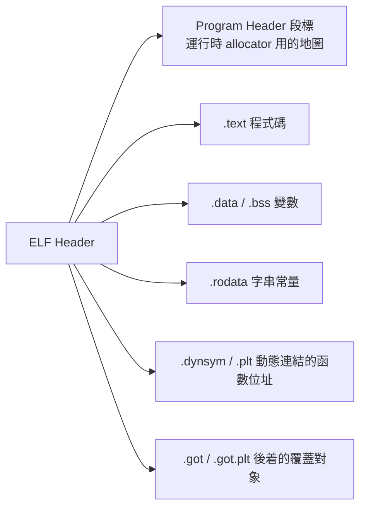

# P1 · 二進制基礎鞏固（30 分鐘）

> 內容：ELF 檔案/程式結構、x64 calling convention、棧的實際佈局、常用工具。這一章是後面所有內容的語言基礎。

---

## 1 · 「Pwn 題」的樣貌

賽場給你一個 ELF 檔（有時連 libc、ld），目標經常是：

```text
遠端 nc host port → 遠端程式跑同個 ELF → 利用弱點 → `/bin/sh` → cat flag
```

> 賽場流程：先用 `file` 檢查架構/位數 → `checksec` 檢查防禦 → `./pwn` 本地玩一遍 → 開始分析。

---

## 2 · ELF 的結構

### 2.1 一分鐘結構圖



### 2.2 查看命令速查

| 目標 | 命令 |
|---|---|
| 全棧、格式 | `file ./pwn` |
| header | `readelf -h ./pwn` |
| 段 | `readelf -S ./pwn` |
| 動態附接資訊 | `readelf -d ./pwn`、`ldd ./pwn` |
| 函數符號 | `nm ./pwn`、`nm -D ./pwn` |
| 反編譯（不含 libc 名） | `objdump -d -M intel ./pwn` |
| 反編譯（含 libc 名/符號定位） | `objdump -T ./pwn\|grep system` |
| 未帶 str 參數 | `strings ./pwn \| grep -ll 强` |

### 2.3 Relocation（關鍵概念）

- `.plt` 的作用：把每個外部函數（如 `puts`）的**第一次**呼叫重定向到 dynamic linker 去查 real address，從第二次起直接用 `.got.plt` 已儲存的 address。
- `.got` / `.got.plt`：**存放這些外部函數的 real address** —— 是 Pwn 最常被利用的「可寫入的函數指標」。

> 直接用 pwntools 的 `elf.got['puts']`、`elf.plt['puts']` 即可，不必手算。

---

## 3 ·函式調用約定（x86-64 System V ABI）

| 參數序號 | 暫存器 |
|---|---|
| 1 | `RDI` |
| 2 | `RSI` |
| 3 | `RDX` |
| 4 | `RCX` |
| 5 | `R8` |
| 6 | `R9` |
| 7+ | 棧 |

- 返回值 → `RAX`
- 系統呼叫 → 同樣用 `syscall`，
  - 參數：`RDI/RSI/RDX/R10/R8/R9`（注意第 4 個是 R10 不是 RCX）。
  - 呼叫號：`RAX = 標準 Linux syscall  gcc : read=0, write=1, execve=59, 工作安排 in `limits.h`
  - 系統呼叫：`syscall` 指令。

### 32 位元的差異

| 項目 | x86-32 |
|---|---|
| 參數 | **全面走棧**（除非 fastcall） |
| syscall | `int 0x80`、參計 `EBX/ECX/EDX` |
| 呼叫號 | `EAX = 4 read / 3 write / 11 execve` |

---

## 4 · 棧結構與函式 PROLOGUE

### 4.1 一個 VGA 程式的 prologue

```asm
push rbp            ; 保存调用者的栈底
mov  rbp, rsp       ; 當前函式以 RBP 為基準
sub  rsp, N         ; 分配局部變數
```

### 4.2 棧的圖示

3.5 給訊息數再盘点。很多人第一次去看 `objdump` 覺得一團亂，其實關鍵就是下面這張圖：

```svg
<svg viewBox="0 0 900 430" xmlns="http://www.w3.org/2000/svg" font-family="monospace">
  <style> text { fill: var(--fg); font-size: 15px; } .m { fill: var(--muted); font-size: 13px;} 
          .lbl { font-size: 13px; } </style>
  <rect x="60" y="30" width="300" height="40" fill="none" stroke="var(--border)"/>
  <text x="80" y="58">…  high address</text>
  <text x="380" y="58" class="m">↑ push 方向</text>
  <rect x="60" y="70" width="300" height="45" fill="none" stroke="var(--border)"/>
  <text x="80" y="98">[局部變數區  buf[...]</text>
  <text x="380" y="98" class="m">可被溢位</text>
  <rect x="60" y="115" width="300" height="40" fill="none" stroke="var(--border)"/>
  <text x="80" y="141">[caller saved regs …]</text>
  <rect x="60" y="165" width="300" height="40" fill="none" stroke="var(--border)"/>
  <text x="80" y="192">[8 bytes: Canary]</text>
  <text x="380" y="192" class="m">讀寫丟失會 __stack_chk_fail</text>
  <rect x="60" y="215" width="300" height="40" fill="none" stroke="var(--border)"/>
  <text x="80" y="242">[8 bytes: saved RBP]</text>
  <text x="380" y="242" class="m">上一個棧幀的基址</text>
  <rect x="60" y="265" width="300" height="45" fill="none" stroke="var(--border)" stroke="var(--accent)"/>
  <text x="80" y="292">[8 bytes: 返回位址 RET]</text>
  <text x="380" y="292" class="m">溢位需精準蓋到這裡</text>
  <rect x="60" y="320" width="300" height="45" fill="none" stroke="var(--border)"/>
  <text x="80" y="347">[caller stack 參數/傳送 slot0..]</text>
  <rect x="60" y="375" width="300" height="40" fill="none" stroke="var(--border)"/>
  <text x="80" y="402">…  low address</text>
</svg>
```

> 上面這個布局是「x86-64 無 ASLR 的棧」，PWn 的目標常常是把 RET 那一格，改寫成你構造的 ROP 鏈的地址。

### 4.3 查找使用 buffer → ret 的 offset

```bash
# 01 用 pwntools 的 cyclic，可自動定位 offset
cyclic 200 > pat
./pwn < pat   # crash
cyclic -l 0x6161616161616162     # 展示 crash addr 得到 offset。
```

---

## 4 · asm 彙編用法（shellcode）

```python
from pwn import *
context.arch = 'amd64'    # 32be 同  行 am MIPS
shellcode = asm(shellcraft.cat('./flag'))    # 一行指令shellcode
```

> CTF 常用的最小完成，即 shellcode 寫完整狀態；使用 `shellcraft.sh()` 生成 `execve("/bin/sh")`。

---

## 5 · 課堂練習（15 分鐘）

> 練習 26 在 `04-練習/Pwn練習題集.md`。

1. 給下例一個 64-bit simple ELF 的 objdump，說出：哪個函數是 main、哪個 offset 對應 ret addr。
2. `checksec` 出的 Canary 開關，你會想到什麼？

## 6 · 講師提示

- 本講的重頭是 **學員能寫出行為構造 offset 的字形**；講完之後直接讓大家玩 `use-after-mem` 這類小工具。
- 展示 `nx` 缺、`PRIVILEGE` 這些都「跟攻防關係不大」，花 3 分鐘即可。
