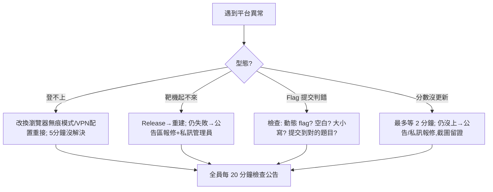

# 第四講 · 攻防平台的操作（0.5 小時）

> 目標：開賽前把「平台側」的所有事情處理乾淨，讓賽場上的每一分鐘都花在解題，而不是花在「flag 提交失敗」、「VPN 接不上」、「附件沒下載」。
> 本講與 `05-模板/賽前檢查清單.md` 互相引用；比賽前一晚請照清單逐項打勾。

---

## 0. 賽前 ready 檢查（開講前 5 分鐘，全員同步操作）

| # | 檢查項 | 怎麼驗證 |
|---|--------|----------|
| 1 | 能登入比賽平台 | 輸入帳密 → 出現題目列表 |
| 2 | 隊伍建立/加入完成 | 平台「Team」頁顯示所有成員 |
| 3 | 附件可下載 | 隨便點一題 → 下載 → 開啟成功 |
| 4 | 動態靶機可建立 | 點「Start Instance」→ 得到 IP/Port |
| 5 | flag 提交流程 | （若平台有測試題）提交一次試玩 flag |
| 6 | 網路代理/VPN 可用 | `nc <靶機 ip> <port>`、`ping` 均通 |
| 7 | 本時區/賽程時間對齊 | 把平台顯示的開賽時間換算為澳門時間（GMT+8），設鬧鐘提前 30 分鐘 |

> 記住一個原則：**賽前能測的都要測一遍**。開賽後任何環境問題都會消耗五人都焦急的 20 分鐘。

---

## 1. 平台的題目模型（以主流平台 GZCTF / CTFd 為基準）

由於 MOCTF 2026 平台的後台可能採用 GZCTF 或 CTFd 等主流先行方案，以下說明覆蓋「兩者共通」與「各自特有」的行為。

### 1.1 題目詳情頁解讀

一個題目通常包含：

```text
● 題目名稱（往往有提示：easy_ssti、babypwn）
● 分值（有的平台是動態分：隨解題人數下降）
● 描述（最重要的情報來源之一！）
  • 附件:一份(binary/pcapng/源碼壓縮包)
  • 配置:動態容器開啟按鈕 / 靜態地址
  • hints:開賽很久後可能由主辦方新增
● Flag 格式說明（如 flag{...}）
● 解題人數（用來判斷難度——高出題讓你應該做到）
```

**描述是一級情報，請逐字讀**：CTF 出題者在描述裡藏了 30% 的解題思路。
例：`"The admin uses a weak password and the app is written in Flask"` ——直接告訴你爆破 + SSTI。

### 1.2 動態靶機（Instance）

| 概念 | 說明 | 賽場操作 |
|------|------|----------|
| 啟動 | 點 Start/Deploy → 獲得 `ip:port`（或 `http://xxx:port`） | 立刻存進筆記，加 `#題目名` |
| 生命週期 | 通常有 TTL（60~120 分鐘），可續期 | 寫一個「每隔 15 分鐘檢查所有 live 容器」的鬧鐘 |
| 疑似掛了 | 容器時間到自動關閉，或叢集重啟 | 重建一個（平台允許重建；記下的 IP 會變，payload 中硬編碼的部分要改） |
| 重建注意 | **flag 在大部分動態題是隨機注入的**，重建後新 flag 與舊 flag **不同** | 一定要用當前容器的 flag 提交 |
| 釋放 | 解完題記得 Release，節省叢集資源（有的平台有總併發上限） | 養成習慣 |

### 1.3 Flag 提交規範

| 項目 | 說明 |
|------|------|
| 大小寫 | 一般嚴格匹配（部分平台不敏感），**原樣複製**即可——不要手打 |
| 空白 | 前後空白會導致失敗；複製後先貼到編輯器 trim 一下再提交 |
| 中括號/大括號 | `flag{...}` 的 `{}` 一定要留 |
| 動態 flag | 每個容器不同，交錯會一直 wrong（常見錯誤） |
| Wrong 次數限制 | 部分平台有答題次數限制或短期鎖定；**不要毫無根據地連提交 10 次** |

> **賽場禮儀**：連續提交錯誤 flag 若平台有「鎖 5 分鐘」機制，會白白浪費時間。凡是提交，先在本地把 payload 輸出與 flag 格式對拍。

### 1.4 通知、公告、Hint

- 平台首頁的 **公告區**（Announcement）要每 20~30 分鐘回頭看一次：主辦會在上面發布「修復了的靶機」、「新 hint」、「延長 30 分鐘」等訊息。
- hint 的開啟有時要花費一定點數、或會降低最終分——**先解完再花點數 hint**，除非隊伍卡住超過 40 分鐘。

---

## 2. 網路存取（動態靶機、內網連線）

### 2.1 常見連線形態

| 形態 | 說明 | 賽場自檢 |
|------|------|----------|
| Active（直接 IP） | 靶機 IP 對公網可直連 | `curl http://ip:port` |
| OpenVPN | 主辦發 `.ovpn` 檔，撥接後才可訪問內網靶機 | `sudo openvpn team.ovpn` → `ip a` 出現 `tun0` |
| WireGuard | 發 `.conf` | `sudo wg-quick up wg0` |
| Web Proxy | 平台上以「訪問按鈕」代理 (如沙箱內建 VNC/web terminal) | 直接點開 |

### 2.2 OpenVPN 常見故障排除

```bash
# 症狀 1: 連上但打不到靶機
ip a | grep tun          # 沒 tun0 → VPN 沒接成功
ping <靶機內網 IP>        # 若通 → 是服務層面問題，不是網路
sudo iptables -L -n      # 看是否本機防火牆擋
# 症狀 2: 斷線重連後 IP 變化
# → 所有 payload/腳本的硬編碼 IP 都要更新（還好一般僅一次）

# 症狀 3: 兩台 VM 都要連? 建議只把 Kali VM 接入 VPN（主戰力機）。
# 若 Host 也要接，注意 route 衝突（一般 --redirect-gateway def1 會罩住）
```

---

## 3. 賽場紀律與禁止事項

> 違反這些規則是有嚴重後果的：除名、成績作廢、上報學校。

1. **禁止攻擊比賽平台本身**（除題目明確聲明）；平台掛了會讓所有人停擺。
2. **禁止攻擊賽場其他隊伍的機器**（Jeopardy 題各隊有獨立容器，不需「打別人」）。
3. **禁止共享 flag**（包括跨隊、私下群、公開聊天室）。
4. **禁止惡意流量**（ddos 掃靶機外的無關網段、對整個 /16 做 nmap -p- ——會被偵測並可能封號）。
5. **寫題過程允許使用 AI 工具**（見本賽制細則），**但** submit 的 flag 必須出自你自己操作的 payload。

---

## 4. 賽場分工與時間管理（結合 `02-方法論` §4.2）

- **開賽前 10 分鐘分工完成**：誰看 Web、誰 Pwn、誰先格子橫掃（把送分題先行清光）。
- **開賽後 30 分鐘**：ICE 順序 = 「分數/難度比最高的題目先碰」；同時信息手開始做 1.3 版本抄錄。
- **每 60 分鐘**：隊內站會 3 分鐘（⑴ 目前分數；⑵ 各自卡點；⑶ 下 60 分鐘的方向）。
- **賽末 40 分鐘**：停止開新題，把有墓碑筆記的半成品題收尾（特別是動態 flag 題：**先重建容器拿新 flag 再提交**）。

---

## 5. 平台故障的處理流程



> 報修的信息格式（直接套）：
> `題目: <name>;  現象: <一句話>;  已嘗試: <重建/更換網路>;  期望: <你希望主辦做的事>;  截圖: <已附>`。

---

## 6. 本講驗收

1. 動態靶機重建後，提交舊 flag 為何會錯？
2. OpenVPN 連上但 ping 不到靶機，下一步的三個檢查項？
3. 15 分鐘內解不開的送分題，正確的處理是？
4. hint 開啟的代價是什麼，何時才值得開？
5. 報修訊息的五個必要欄位是？
