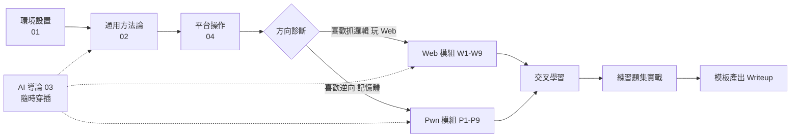

# MOCTF 2026 賽前培訓 · 總覽與使用指南

> 賽事資訊：https://mocsctf2026.mocsctf.com/zh
> 本資料夾為完整的賽前培訓教材：涵蓋「線下前置準備（澳門培訓團隊）」與「線上賽前深造（深職大培訓團隊）」兩大階段的全部主題，含詳細講義、真實案例、可操作模板、練習題與講師執行手冊。

---

## 一、課程結構總覽

### 第一階段：線下前置準備（澳門培訓團隊）

| 序 | 課程 | 時數 | 核心內容 | 教材位置 |
|---|------|------|----------|----------|
| 1 | CTF 環境設置及準備 | 1 小時 | VM、Python、Kali/Ubuntu、瀏覽器、代理、本地題目鏡像 | `01-CTF環境設置及準備.md` |
| 2 | CTF 攻防賽通用方法論 | 3.5 小時 | 信息收集 SOP、CVE 檢索與 PoC 適配、Bypass 思維 | `02-CTF-攻防賽通用方法論.md` |
| 3 | AI 輔助攻防技術導論 | 1 小時 | 多模型協作、提示詞工程、防提示注入、Code Review 具現化 | `03-AI輔助攻防技術導論.md` |
| 4 | 攻防平台操作 | 0.5 小時 | 組隊、題目/Flag 格式、允許與禁止行為、平臺故障處理 | `04-攻防平台操作.md` |
| — | 總課程設計（課時分配/教學法/分流標準） | — | 供講師與課程負責人參考 | `06-講師包/課程執行手冊.md` |

### 第二階段：線上深造（深職大培訓團隊）

#### A. Web 攻防模組（3 小時）

| 序 | 主題 | 教材位置 |
|---|------|----------|
| W0 | 目錄（模組說明與入口） | `02-線上-Web/00-模組說明與時間表.md` |
| W1 | CVE 利用與信息收集類 | `02-線上-Web/01-CVE利用與信息收集.md` |
| W2 | 注入類漏洞（SQLi/NoSQL/命令注入） | `02-線上-Web/02-注入類漏洞.md` |
| W3 | 遠端程式碼執行（RCE） | `02-線上-Web/03-遠端程式碼執行.md` |
| W4 | 檔案包含與讀取（LFI/RFI/上傳） | `02-線上-Web/04-檔案包含與讀取.md` |
| W5 | SSRF 與 XXE | `02-線上-Web/05-SSRF與XXE.md` |
| W6 | 反序列化漏洞 | `02-線上-Web/06-反序列化與SSTI.md`（§反序列化） |
| W7 | 樣板注入（SSTI） | `02-線上-Web/06-反序列化與SSTI.md`（§SSTI） |
| W8 | 複合邏輯漏洞鏈 | `02-線上-Web/07-複合邏輯漏洞鏈.md` |
| W9 | Code Review 與 Patch 實作 + AI 輔助審計 | `02-線上-Web/08-Web程式碼審計與修補.md` |
| — | 練習題集 | `04-練習/Web練習題集.md` |

#### B. Pwn 攻防模組（3 小時）

| 序 | 主題 | 教材位置 |
|---|------|----------|
| P0 | 目錄（模組說明與入口） | `03-線上-Pwn/00-模組說明與時間表.md` |
| P1 | 二進制基礎鞏固（ELF/流程/工具） | `03-線上-Pwn/01-二進制基礎鞏固.md` |
| P2 | ELF 結構、PLT/GOT、調用約定、棧結構 | `03-線上-Pwn/02-保護機制與checksec.md`（§含棧結構） |
| P3 | 保護機制：PIE/Canary/NX/RELRO | `03-線上-Pwn/02-保護機制與checksec.md` |
| P4 | pwntools 基本操作與調試環境（gdb+pwndbg） | `03-線上-Pwn/03-pwntools與調試環境.md` |
| P5 | 棧溢出與 ret2libc | `03-線上-Pwn/04-棧溢出與ret2libc.md` |
| P6 | 命令注入類與 C 程式邏輯追蹤 | `03-線上-Pwn/05-命令注入與C程式碼邏輯追蹤.md` |
| P7 | 格式化字串漏洞 | `03-線上-Pwn/06-格式化字串漏洞.md` |
| P8 | MIPS32 架構基礎 | `03-線上-Pwn/07-MIPS32架構基礎.md` |
| P9 | Pwn Code Review 與 Patch 實作 + AI 輔助逆向 | `03-線上-Pwn/08-Pwn程式碼審計與修補.md` |
| — | 練習題集 | `04-練習/Pwn練習題集.md` |

### C. 共用模板與講師資源

| 資源 | 教材位置 |
|------|----------|
| pwntools 通用腳本模板 | `05-模板/pwntools攻擊腳本模板.py` |
| Writeup 標準格式 | `05-模板/Writeup報告模板.md` |
| AI 提示詞庫（攻/防/審計） | `05-模板/AI提示詞庫.md` |
| 賽前檢查清單（選手） | `05-模板/賽前檢查清單.md` |
| 講師執行手冊（含時間表、課前清單、聽課學員注意） | `06-講師包/課程執行手冊.md` |

---

## 二、學習路徑

### 路徑 1：完全新手 → 參賽資格



### 路徑 2：賽前 7 天衝刺計畫

| 天別 | 主攻 | 輔助 |
|------|------|------|
| D-7 | 全套課程重點快速過一遍 | 建好 VM 與豁免清單 |
| D-6 | 通用方法論+Bypass 套路 | 寫好資訊收集腳本 |
| D-5 | Web W1-W4（ CVE/注入/RCE/LFI） | 練 3 題注入 |
| D-4 | Web W5-W9（SSRF/Serialize/SSTI/Chain/Review） | 練 2 題複合鏈 |
| D-3 | Pwn P1-P5（基礎/保護/棧） | 練 ret2libc |
| D-2 | Pwn P6-P9（格式化字串/MIPS） | 練格式化字串 + MIPS 識別 |
| D-1 | 檢查清單+AI 提示詞庫背誦 | 模擬賽（用練習題計時） |
| 比賽日 | 武器庫上場 | 遵守賽場紀律（`05-模板/賽前檢查清單.md`） |

---

## 三、教材撰寫原則（供講者補充時遵守）

1. **真實案例優先**：每個技術點都應對應真實 CVE 編號、真實賽事題目風格、或通用 Open Source 專案真實歷史漏洞。
2. **繁體中文正字法**：除檔名兼容問題外，內文一律使用台灣/香港慣用繁體用語（「伺服器」「程式」「檔案」「軟體」「網路」等）。
3. **可操作優先於理論**：給指令就給完整可複製指令；給腳本就給可直接執行版本。
4. **道德約束**：教材僅限 CTF 賽事與本地靶機演練，所有練習在 `127.0.0.1`、內部靶機、或賽事平臺內進行。禁止對未授權真實系統操作。

---

## 四、快速開始

### 學員

```bash
# 依序閱讀
# 1. 01-CTF環境設置及準備.md  → 把 VM 架好
# 2. 02-CTF-攻防賽通用方法論.md → 瞭解策略
# 3. 按 Web 或 Pwn 方向進入子目錄
# 4. 05-模板/賽前檢查清單.md → 賽前一晚逐項打勾
```

### 講師

```bash
# 1. 先讀 06-講師包/課程執行手冊.md（含時間配置、教前清單）
# 2. 準備 demo 環境：Web/09 與 Pwn/09 是「須 demo」課程
# 3. 有問題可翻 `05-模板/AI提示詞庫.md` 找課堂互動用提示
```

---

## 五、文件規範

- 所有 markdown 檔案以章節標題分節，目錄以 `##` 開頭。
- 程式碼區塊必須標注語言（`bash` / `python` / `c` / `php` 等）。
- 終端輸出使用 `text` 或不加標注。
- 引用外站資料時，一律附上連結；不轉載大段原文。

---

## 六、回饋與更新

- 發現錯誤：請在檔頂加「勘誤」區塊並寫明日期。
- 每年賽後：把當年新技術、新題型併入對應章節。
- 大版本更動：更新本 README 與 `06-講師包/課程執行手冊.md` 的對應章節。
